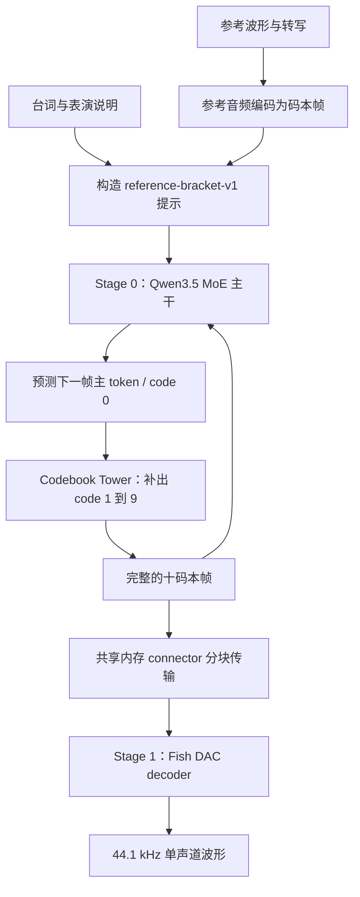

# Fish Audio Drama 3：把台词变成有表演的声音

> 面向刚接触 AI 与 Omni 的读者。本文核对的是 `fishaudio/drama-3`，以及本地 vLLM-Omni `910b8f07d23c7f387729173333c9d5f927dc6c4f` 的 `fish_omni` 实现；不是把 Fish S2 的架构换个名字。

## 从 checkpoint 到模型结构：先看积木长什么样

### A. 本次读的是哪一份权重

固定 Hugging Face revision：`e0a9218aa48888270f06ef1ed9ea67622c0e17d2`。

[固定版本文件树](https://huggingface.co/fishaudio/drama-3/tree/e0a9218aa48888270f06ef1ed9ea67622c0e17d2) 中，与加载相关的真实文件是：

```text
fishaudio/drama-3/
├── config.json
├── model.safetensors.index.json
├── model-00001-of-00008.safetensors
├── ...                         # 连续八个分片
├── model-00008-of-00008.safetensors
├── codec.pth
├── tokenizer.json
├── tokenizer_config.json
├── special_tokens_map.json
└── chat_template.jinja
```

checkpoint 是“训练结果的存档”：`config.json` 描述组装规则，safetensors 保存学到的矩阵，index 把矩阵名称映射到分片，tokenizer 定义输入文本怎样变成编号。

文件分成八片只为存储和加载，不代表八层模型、八张 GPU 或八位说话人。

本章用 HTTP Range 读取 safetensors 的 8 字节头长度和 JSON header，**没有下载完整大权重**。header 内部记录真实 tensor 名、shape、dtype；它能证明矩阵尺寸，不能证明运行精度或听感。

[精简可复核清单](checkpoints/fishaudio-drama3.json) 保存本节选中的真实矩阵、固定 revision 和读取方法。

### B. config 规定了怎样的骨架

以下来自这份 checkpoint 的实际 config，不是仅抄本地 Python 类的默认参数：

| 组件 | 层数 | hidden | Q / KV 头数 | head_dim | FFN 中间宽度 |
| --- | --- | --- | --- | --- | --- |
| 文本主干 | 40（30 线性 + 10 完整注意力） | 2048 | 16 / 2（完整注意力） | 256（完整注意力） | 每路由 / 共享专家均为 512 |
| 码本塔共享层 | 4 | 2048 | 16 / 2 | 256 | 6144 |
| 码本塔残差预测层 | 9（10 码本减 1） | 2048 | 16 / 2 | 256 | 6144 |

| 其他结构字段 | 实际配置 |
| --- | --- |
| 文本词表 | 252288 |
| 线性注意力 key / value 头 | 16×128 / 32×128 |
| 路由专家数 / 每 token 选择数 | 256 / 8 |
| 主干注意力排列 | [linear, linear, linear, full] 重复 10 次 |
| 音频码本数 / 每码本词表 | 10 / 4096 |

注意 $16\times256=4096$，**不是**隐藏维度 2048。注意力投影可以先把 2048 维映射到更宽的多头空间，再投影回来；不能用 `hidden_size / heads` 擅自改掉 checkpoint 明示的 `head_dim`。

tower 的残差预测层数由 `num_codebooks-1=9` 得到。配置与 `CodebookTower` 的组装规则一起说明它是 4 个共享层 + 9 个码本层；不是从文件大小猜出来。

### C. 怎么读一个 Linear 的 shape

PyTorch `Linear(in_features, out_features)` 的权重存成 `[out,in]`。如果输入 $X$ 的形状为 $[B,S,H]$，则：

$$
Y=XW^\top+b.
$$

$B$ 是批内请求数，$S$ 是位置数，$H$ 是每个位置的隐藏维度。若 $W=[512,2048]$，输入 $[B,S,2048]$，输出就是 $[B,S,512]$。

实际 vLLM 经常把不同请求的 token 打包成 `[rows,H]`，而不是保持矩形 `[B,S,H]`；线性变换最后一维的规则相同。

Embedding 权重 `[vocab,H]` 则像查字典：输入整数 `[B,S]`，查出 `[B,S,H]`，不是把编号本身拿去做矩阵乘法。

### D. 实读权重：从大矩阵反推部件

下列名称与 shape 来自 safetensors header；为保持可读性，`L` 表示原名前缀 `model.language_model.layers`，并非权重里的真实缩写。

```text
model.language_model.embed_tokens.weight    [252288,2048] BF16
L.0.linear_attn.in_proj_qkv.weight           [8192,2048]   BF16
L.0.linear_attn.conv1d.weight                [8192,1,4]    BF16
L.0.linear_attn.out_proj.weight              [2048,4096]   BF16
L.3.self_attn.q_proj.weight                  [8192,2048]   BF16
L.3.self_attn.k_proj.weight                  [512,2048]    BF16
L.3.self_attn.v_proj.weight                  [512,2048]    BF16
L.3.self_attn.o_proj.weight                  [2048,4096]   BF16
L.0.mlp.experts.0.gate_proj.weight            [512,2048]    F8_E4M3
L.0.mlp.experts.0.up_proj.weight              [512,2048]    F8_E4M3
L.0.mlp.experts.0.down_proj.weight            [2048,512]    F8_E4M3
L.0.mlp.experts.0.gate_proj.weight_scale_inv  [4,16]        F32
```

第 0 层与第 3 层使用不同前缀，印证了混合注意力；不能把每一层都画成相同的标准 self-attention。

线性注意力的 Q/K 宽度各为 $16\times128=2048$，V 宽度为 $32\times128=4096$，因此合并投影宽度为 $2048+2048+4096=8192$。

完整注意力的 query 宽度为 4096，但 `q_proj` 有 8192 行：配置启用了输出门控，还需要等宽的 gate，不能把它误读成 32 个 query heads。K/V 各为 $2\times256=512$。

FFN 可以理解为“先变宽、非线性处理、再变回去”。这里每个稀疏专家的中间宽度为 512，不能用 tower 的 6144 套进专家 FFN。

FP8 权重不是一串打包的 int4 数字：header 的 dtype 是 `F8_E4M3`。量化尺度另存为 F32 tensor，`[512,2048]` 按 $128\times128$ 块对应 $[4,16]$ 个尺度。它说明的是权重表示布局，不是“整个 forward 全程 FP8”。

实际反量化或量化 kernel 如何使用 `weight_scale_inv`，应以对应加载与 kernel 为准，不能仅凭字段名猜乘法或除法方向。

### E. Tower 的真实矩阵与一次 forward

```text
audio_decoder.codebook_embeddings.weight                  [40960,2048]
audio_decoder_mtp_shared.layers.0.semantic_embedding.weight [4096,2048]
audio_decoder_mtp.layers.0.eh_proj.weight                  [2048,4096]
audio_decoder_mtp.layers.0.transformer_layer.attention.wqkv.weight
                                                         [9216,2048]
audio_decoder_mtp.layers.0.transformer_layer.attention.wo.weight
                                                         [2048,4096]
audio_decoder_mtp.layers.0.transformer_layer.feed_forward.w1.weight
                                                         [6144,2048]
audio_decoder_mtp.layers.0.transformer_layer.feed_forward.w2.weight
                                                         [2048,6144]
```

以上选中 tower 权重的 dtype 都是 BF16。共享码本 embedding 有 $10\times4096=40960$ 行，用码本编号的偏移量查各自字典，而不是一个有 40960 种音色的列表。

`wqkv` 的 9216 行按源码依次拆成：

```text
query 4096 | output gate 4096 | key 512 | value 512
```

因此输入 `[rows,2048]` 先变成 `[rows,9216]`；Q 再 reshape 成 `[rows,16,256]`，K/V 成 `[rows,2,256]`。attention 后的 4096 维结果乘 gate，再经 `wo` 回到 2048 维。

`eh_proj=[2048,4096]` 说明它把拼接后的两组 2048 维信息压回 2048 维。读模块实现时，应同时看 concat 的顺序，不能只按名称猜语义。

### F. 权重怎么装进 Omni 的模块

[`FishOmniForConditionalGeneration.load_weights`](https://github.com/vllm-project/vllm-omni/blob/910b8f07d23c7f387729173333c9d5f927dc6c4f/vllm_omni/model_executor/models/fish_omni/fish_omni_model.py#L536) 把三类 `audio_decoder*` 前缀分给 `self.tower`，逐项检查名称与 shape，再复制到同名参数。

例如 checkpoint 的 `audio_decoder_mtp.layers.0...wqkv.weight` 对应 `self.tower.audio_decoder_mtp.layers[0]...wqkv.weight`。其余主干权重交给继承的 Qwen3.5 MoE loader；这部分还依赖配套 vLLM 的名称映射与并行切分实现。

因此“磁盘矩阵形状”不一定等于“某张卡上运行时参数形状”：vLLM 可融合 Q/K/V、融合 gate/up 或进行并行切分；本章先解释原始 checkpoint，再解释实际 forward，不能把两个层级混在一起。

[`ExpertFp8Config`](https://github.com/vllm-project/vllm-omni/blob/910b8f07d23c7f387729173333c9d5f927dc6c4f/vllm_omni/model_executor/models/fish_omni/quantization.py#L19) 对普通 Linear 选择不量化实现，对路由专家复用块 FP8 路径。这正是为什么 header 同时出现 BF16、FP8 和 F32。

`codec.pth` 是另一份 codec 权重，不在 safetensors 分片中。本节没有下载或反序列化它，因此不伪造其内部 tensor shape；后面的 codec 输出格式依据当前 Omni pipeline 与 codec 实现说明。


## 1. 先理解它解决什么问题

普通文字转语音（TTS，Text-to-Speech）要求“把字读对”。Drama 3 还希望控制“怎么演”：同一句“你终于来了”，可以是放松、愤怒、压低声音或带着笑意。

输入中可以包含台词、说话人标记、自然语言表演说明，以及参考声音与其文本。输出是声音波形，即扬声器最终播放的一串采样值。

先把它想成一个录音棚：

- 文本主干负责理解剧本、记住上下文，并推进声音的时间线。
- codebook tower（码本塔）负责补齐每一小段声音的细节。
- 音频 codec（编解码器）的解码端负责把压缩表示还原为声音。

它不是“先生成一篇文字回答，再交给一个外部配音模型”。语音生成主干直接预测音频离散表示。

**学习目标**：看完能解释为什么有两种缓存、为什么 3B active 不等于只需装入 3B 权重，以及流式首包为什么受 codec 分块影响。

## 2. 模型身份与证据边界

正式名称是 **Fish Audio Drama 3**，模型仓库为 `fishaudio/drama-3`，配置的 `model_type` 为 `fish_omni`。

官方模型配置与本地实现共同给出以下结构信息：

- 文本主干是 Qwen3.5 MoE 形态，混合线性注意力与完整注意力。
- `text_config` 为 40 层，隐藏维度 2048；每个位置从 256 个路由专家中选择 8 个，另有共享专家。
- 音频帧有 10 个码本，每个码本的取值空间为 4096。
- 本地 `CodebookTower` 包含 4 个共享层和 9 个残差预测层，共 13 层。
- 本地 pipeline 的最终输出为 44.1 kHz 单声道音频。

“35B 总参数、每 token 约 3B 激活”是官方模型规模描述。它描述稀疏计算量，不能直接推出显存需求或端到端速度。

官方能力和具体接口能力需要分开：本地 recipe 明确指出，当前 speech API 尚未暴露 `previous_takes` 编辑续写和长文本分块。看到官方编辑演示，不能据此认定本地 API 已支持同样操作。

来源：[官方模型卡](https://huggingface.co/fishaudio/drama-3)、[官方配置](https://huggingface.co/fishaudio/drama-3/blob/main/config.json)、[官方代码](https://github.com/fishaudio/fish-speech)。配置按 2026-10-15 阅读，后续可能变化。

## 3. 声音为什么也能变成 token

文本 token 通常代表字、词或词片段。音频 token 则代表 codec 学出来的声音片段编码，不是汉字，也不是声学频谱中的一个频率。

设一段声音包含 $T$ 帧，每帧由 $Q=10$ 个码本编号表示：

$$
C\in\{0,\ldots,4095\}^{T\times10}.
$$

可以把每帧理解为“主轮廓 + 多次细节补充”。这只是理解多码本的直觉，不意味着某个码本严格只负责音高或音色。

例如某一帧的编码可能是：

```text
[137, 85, 902, 7, 618, 245, 90, 12, 811, 42]
```

这些编号必须通过训练好的 codec 解码才能听见，不能把 `137` 当作采样值。

本地 codec 的采样率为 44100、hop length 为 2048，所以 $44100/2048\approx21.53$ 帧/秒（[codec 常量](https://github.com/vllm-project/vllm-omni/blob/910b8f07d23c7f387729173333c9d5f927dc6c4f/vllm_omni/model_executor/models/fish_speech/dac_utils.py#L11)）。1 秒的音频由几十个时间步、每步 10 个码本编号描述，而不是让语言模型逐个预测 44100 个波形采样点。

计算压缩主要发生在**表示空间**：语言模型处理较低频率的音频帧，codec 承担采样级还原。codec 自身仍然需要计算。

## 4. Pipeline：两个引擎阶段，三个逻辑部件



图中的主干和 tower 同属 Stage 0。不能因为画了三个部件，就说有三个独立的调度阶段。

`pipeline.py` 把 Stage 0 标成 `LLM_AR`：AR 是 autoregressive，自回归，即新输出依赖已经产生的输出。Stage 1 消费码本帧并产生音频。

两阶段既可以共享一张 GPU，也会争用这张 GPU 的计算和显存带宽。异步 connector 使阶段可以解耦，并不会创造额外算力。

### 4.1 提示不仅是一串文字

[`prompt.py::build_prompt_frames`](https://github.com/vllm-project/vllm-omni/blob/910b8f07d23c7f387729173333c9d5f927dc6c4f/vllm_omni/model_executor/models/fish_omni/prompt.py#L57) 构造的提示是：

```text
[prompt_len, 1 + num_codebooks] = [prompt_len, 11]
```

每一行由一个主 token 加十个码本位置组成。文字行的音频码本位置填零；参考音频行装入实际码本编号。

参考音频行的主 token 为 `semantic_begin_id + code0`。这是把音频编号放进语言模型词表中指定区间的方式。

这里的 11 列是**输入协议**，不表示最终音频有 11 个声道。

### 4.2 一个时间步发生什么

假设已经生成帧 $1$ 到 $t$：

1. 主干读取当前位置及历史状态，预测下一帧的主 token。
2. 若主 token 属于音频语义区间，把它换回 code 0。
3. tower 结合主干隐藏状态、输入帧以及新 code 0，继续产生 code 1 到 9。
4. 完整新帧成为后续生成的输入，也送往 codec。
5. 若采到终止 token，结束生成并处理尾块。

主干隐藏状态是长度为 $H$ 的实数向量；token 是离散整数。二者不能混为一谈。

### 4.3 Tower 为什么不是每帧失忆的小 MLP

本地 `codebook_tower.py` 的每层都有沿时间轴累积的 K/V 历史。它不只看到当前帧，也能使用前面台词和参考声音对应的状态。

源码注释特别说明：序列位置 $p$ 的 tower 读取主干在 $p$ 的最终归一化状态和输入帧，预测 $p+1$ 的码本。读代码时要注意这个偏移，否则容易把输入帧和目标帧画在同一位置。

这里虽然使用 MTP 命名，但不能直接解释成“猜测解码，一次无条件接受多个未来时间帧”。它主要补齐同一音频帧的多个码本。

## 5. 主干：稀疏专家与混合记忆

### 5.1 MoE：许多专家，每次只请一部分

MoE 是 Mixture of Experts，混合专家。可以把前馈网络想成一组专业处理器，路由器为当前 token 选择其中一部分。

简化公式是：

$$
y(x)=E_{shared}(x)+\sum_{i\in\operatorname{TopK}(r(x))}g_i(x)E_i(x).
$$

$E_i$ 是专家，$r$ 是路由分数，$g_i$ 是混合权重。公式用于说明稀疏选择，不代替该模型完整的归一化与门控实现。

省掉的是未选中专家本次的计算；所有专家的权重仍需存放在设备或某种加载系统中。并发不同 token 可能选择不同专家，还会影响实际 kernel 利用率。

### 5.2 混合注意力：两种记忆机制并存

完整注意力把历史 K/V 留下来，新查询访问历史位置。长序列的缓存随长度增加。

线性注意力类层把历史压入递推状态；本地采用 Qwen3.5 的 gated delta net 路径。不要把它理解成“完整注意力删掉 softmax 后一切等价”，两者是不同的模型结构。

Drama 3 的配置是三层 `linear_attention` 后接一层 `full_attention` 的重复排列。因此：

- 主干中完整注意力层需要相应 KV cache。
- 线性注意力层需要递推状态，本地配置指定其 SSM 状态为 float32。
- tower 还拥有自己独立的 KV cache。

调服务显存时只估算“语言模型 KV cache”会漏掉后两类开销。

## 6. 为什么缓存能少算：从因果性推出来

先看单个注意力头的简化写法：$h_j$ 是位置 $j$ 进入该层注意力投影的隐藏向量，$W_K$、$W_V$ 是训练后固定的 key/value 投影矩阵。位置 $j$ 的 key 与 value 为：

$$
k_j=W_Kh_j,\qquad v_j=W_Vh_j.
$$

因果模型中，前面位置的 $h_j$ 不会因为未来追加新帧而改变。因此生成第 $t$ 帧时，可以保留旧 $k_j,v_j$，只计算新增位置的投影。

然后仍要计算新 query 对历史的注意力：

$$
\operatorname{Attn}(q_t,K_{\le t},V_{\le t})
=\operatorname{softmax}(q_tK_{\le t}^{\top}/\sqrt d)V_{\le t}.
$$

这里 $q_t$ 是当前位置隐藏向量经 query 投影得到的查询，$K_{\le t}$、$V_{\le t}$ 是截至当前位置的历史 key/value，$d$ 是每个 query/key 头的向量维度；除以 $\sqrt d$ 用于控制点积分数的尺度。

例如只看一个头，若历史有 5 个位置且 $d=256$，则 $q_t$ 为 $[1,256]$、$K$ 为 $[5,256]$，点积得到 $[1,5]$ 的相关性分数；softmax 把它变成五个位置的权重，再加权读取 $V$。实际实现还有多头、归一化和位置编码，上式省略这些细节以突出缓存原理。

省掉的是历史投影与历史位置网络的重复计算，不是把“读历史”完全变成零成本。

形象地说：已经做好的录音笔记保留，新台词只增补一页；演员仍然可能翻看之前的笔记。

本地 `TowerKVCache` 每层分配 K、V 张量，形状接近：

```text
[slots + 1, rounded_max_len, kv_heads, head_dim]
```

额外的 slot 用于图回放中的 padding 行，避免覆盖真实请求缓存。生产代码中的缓存还包含所有权与回收问题，远不止 `torch.cat`。

## 7. 本地已经实现的推理优化

以下“已实现”只表示在上述 SHA 的源码能找到，不表示本文重新跑过 GPU benchmark。

**块 FP8 专家权重适配。** `quantization.py` 把 checkpoint 的 `bsgemm-moe` 描述映射到 vLLM 可使用的块 FP8 专家路径。量化减少部分权重存储与读取；不能说全模型都变成 FP8，其他权重与状态还有自己的 dtype。

**主干图执行。** `fish_omni.yaml` 配置 `FULL_AND_PIECEWISE` 与多组 capture size。CUDA Graph 把重复执行的 GPU 工作录成可回放的图，降低 CPU 发起许多小 kernel 的成本；不会自动减少模型层数。

**Tower 独立图。** `TowerDecodeGraphs` 为不同 batch size 捕获解码图。提示预填充仍走 eager，tower 外层也没有直接宣称通用图安全。主干图与 tower 图是两套路径。

**批量 tower 与缓存 attention。** `TowerBatch` 描述多个请求的 slot、位置与长度；可用时选择 paged flash attention，减少朴素 attention 的中间开销。

**参考声音缓存。** `_reference_codes` 可按声音身份缓存参考编码。它节省重复编码，不会把一条新台词的生成工作全部缓存掉。

**异步分块 codec。** 默认初始块 2 帧，后续块 25 帧，并携带 25 帧左上下文。小首块有利于提早出声；后续较大块可摊薄固定开销。左上下文参与边界还原，不应该在客户端被重复播放。

## 8. 优化时应该先量什么

先分清三个指标：

- TTFA：从发请求到第一段可播放音频出现的时间。
- RTF：生成耗时除以输出声音时长，越低通常越快。
- 并发吞吐：单位时间完成多少请求或生成多少音频时长。

理论上可进一步研究码本 tower 批处理、codec 调度、chunk size 与专家量化，但每一项都要做对照实验。

推荐固定台词、参考音频、随机性控制与并发，只改一个选项，并记录首包、尾包、显存和实际音频。尤其听开头是否只发出一个词后变成静音；请求 HTTP 成功不能替代听感验证。

本地 recipe 记录过特定 H100 环境数据，本文不将它移植为其他 GPU、其他版本的性能承诺。

## 9. 一个可以理解的数据流实验

台词可以先用没有行首事件的短句：

```text
<|speaker:0|> 今天先把注意力缓存讲清楚。说到这里，[laughs] 我们终于不用每次重算历史了。
```

本地服务启动方式来自 recipe：

```bash
vllm serve fishaudio/drama-3 --omni --port 8091
```

它需要匹配的 vLLM/Omni 环境和足够 GPU 显存；本文未在读者机器上执行此命令。

先用普通句子建立基线，再加入中间事件，再加入参考声音。这样声音不对时才知道是哪一个条件改变了行为。

说话人标签是专门 token；`[laughs]` 等描述属于普通文本指令。模型能接受一种文字写法，不意味着每次都能精确执行它。

## 10. 读源码的最短路线

以下路径均相对 **vLLM-Omni** 仓库：

1. `model_executor/models/fish_omni/pipeline.py`：先数 stage，找输入来源和最终输出。
2. `deploy/fish_omni.yaml`：核对 GPU 布局、chunk 参数、图执行和精度配置。
3. `model_executor/models/fish_omni/configuration_fish_omni.py`：理解 checkpoint 怎样转换成 Qwen3.5 配置。
4. `model_executor/models/fish_omni/prompt.py::build_prompt_frames`：画出文字行、参考声音行。
5. `model_executor/models/fish_omni/fish_omni_model.py::compute_logits`：看输出词表如何限制到语义 token 与终止符。
6. `model_executor/models/fish_omni/codebook_tower.py::CodebookTower.run`：跟踪 code 0 到 code 9。
7. 同文件 [`TowerKVCache`](https://github.com/vllm-project/vllm-omni/blob/910b8f07d23c7f387729173333c9d5f927dc6c4f/vllm_omni/model_executor/models/fish_omni/codebook_tower.py#L73)、[`TowerDecodeGraphs`](https://github.com/vllm-project/vllm-omni/blob/910b8f07d23c7f387729173333c9d5f927dc6c4f/vllm_omni/model_executor/models/fish_omni/codebook_tower.py#L511)：分别看状态正确性与执行优化。
8. `model_executor/stage_input_processors/fish_speech.py`：看完整帧怎样交给复用的 DAC 阶段。

以上路径前均加 `vllm_omni/`。模块名仍叫 `fish_speech` 的阶段转换函数是复用代码，不能据此把 Drama 3 主干认作 S2。

[当前核对源码树](https://github.com/vllm-project/vllm-omni/tree/910b8f07d23c7f387729173333c9d5f927dc6c4f/vllm_omni/model_executor/models/fish_omni)。固定提交已核实可在上游访问。

## 11. 自测：能否把结构与优化连起来

1. 为什么有了主干 KV cache，tower 仍需要自己的缓存？
2. 每 token 仅激活约 3B 参数，为什么显存不只按 3B 算？
3. 首块从 2 帧改成 25 帧，首包和 codec 调用次数可能分别怎样变化？
4. 为什么声音自然、文字正确和服务吞吐必须分别测量？

参考答案：tower 是另一组带历史注意力的层；总权重与多类运行状态都要占内存；首包可能延后但固定调用成本可摊薄；模型质量与执行效率由不同机制决定，单个指标不能代表全部。

## 延伸阅读

- [Fish Speech 官方推理文档](https://speech.fish.audio/inference/)：区分官方运行时与 Omni 适配。
- [Drama 3 技术报告](https://github.com/fishaudio/fish-speech/blob/main/docs/assets/Fish_Audio_Drama_3_Technical_Report.pdf)：训练、架构与评测的原始材料。
- [本地实现对应 recipe](https://github.com/vllm-project/vllm-omni/blob/910b8f07d23c7f387729173333c9d5f927dc6c4f/recipes/fishaudio/Drama-3.md)：查看环境、命令与限制，性能数字必须连同条件阅读。
