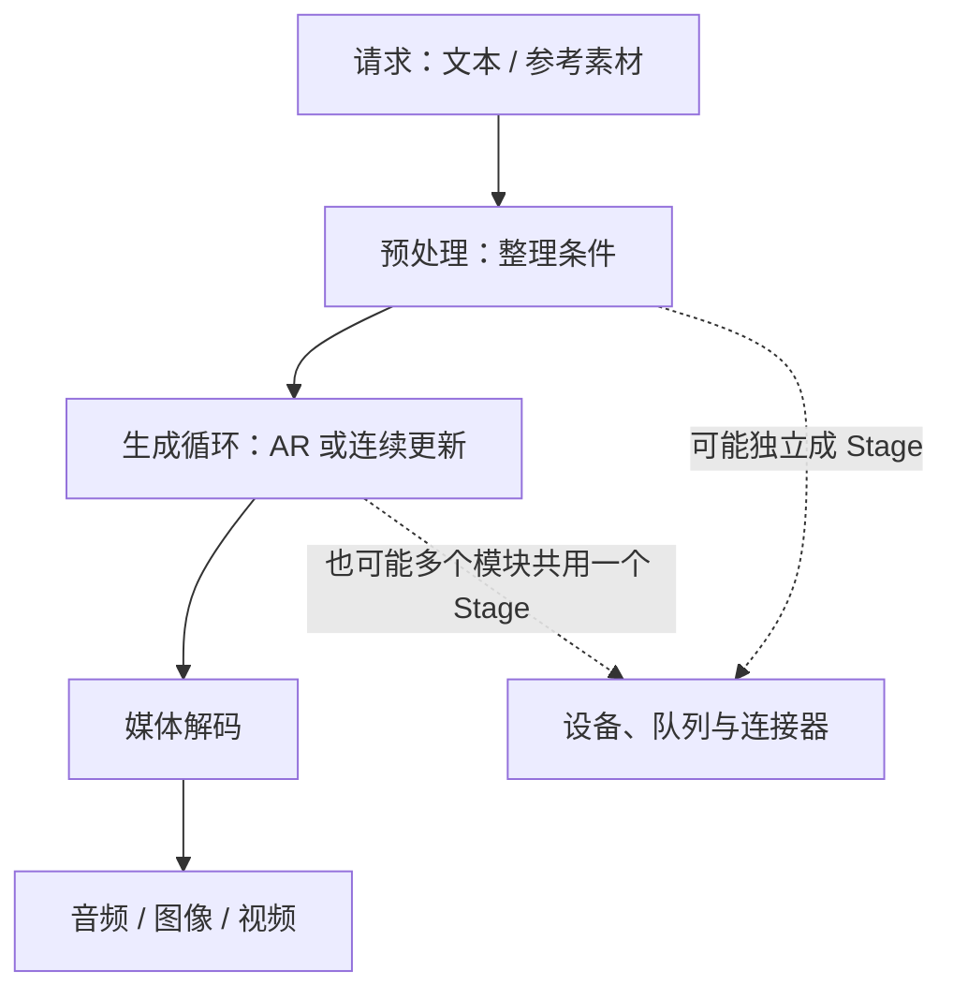

---
tags:
  - modeling
  - 学习路径
  - 多模态
---

# modeling：从模型结构走到 Omni 推理

同样是输入文字，为什么有的模型逐帧“写”出语音，有的反复更新一张带噪图片，还有的要先规划音乐、再还原细节？这一章从这些问题出发，解释模型怎样计算，以及 Omni 为什么要把它拆成不同阶段。

你不需要先读完所有源码。每篇先跟着一个小例子走通输入和输出，再逐层认识张量、生成循环、缓存和优化。

## 先从权重认识模型的骨架

一份 checkpoint 不只是一个“大文件”。读它时，先把三种信息对上：

1. **配置**说明要创建什么模块：例如多少层、隐藏维度多大、注意力头数多少。复合模型可能有多个子目录和配置。
2. **权重**保存训练得到的张量：名称指向模块，shape 说明参数如何连接，dtype 说明保存精度。分片索引中的 `weight_map` 只告诉你张量在哪个文件，不直接给出 shape。
3. **执行代码**说明模块怎样使用这些参数：哪些层重复调用、哪些权重融合、哪些状态在一次请求中保留。

例如，以下是一组**教学用的假设值**，不是这五个模型中某个 checkpoint 的实测配置：

```text
config: hidden_size=2048, intermediate_size=8192, num_hidden_layers=28

model.layers.0.mlp.up_proj.weight    [8192, 2048]
model.layers.0.mlp.down_proj.weight  [2048, 8192]
...
model.layers.27.*                   第 28 个 block 的参数
```

PyTorch 的普通 Linear 权重按 `[输出维度, 输入维度]` 保存。
若输入 `X` 为 `[B,S,2048]`，`up_proj` 做的就是 `X @ W.T`，输出为 `[B,S,8192]`；`down_proj` 再将最后一维变回 2048。`B` 是 batch 大小，`S` 是当前处理的序列长度。两个维度由请求决定，不会出现在这个二维权重的 shape 中。

“28 层”通常指重复 28 次 Transformer block，不表示模型只有 28 个权重矩阵。每个 block 还包含注意力投影、前馈网络和归一化等参数。多头注意力还可能把投影结果拆成 `[B,S,头数,每头维度]`；GQA 的 Q 头数与 KV 头数可以不同，所以 Q/K/V 权重也不一定同形。

也不要默认 `hidden_size = 头数 × head_dim`。注意力可以先将残差流投影到另一种宽度，再由输出投影变回隐藏维度；某些模型的投影还额外带门控向量。这些差别需要联合核对配置、真实权重 shape 和 forward 中的拆分操作。

权重文件里的存储布局也可能和运行时不同：加载器可以把 Q/K/V 合并、将矩阵分给多张卡，或把量化整数与 scale 交给专门内核。因此每篇新增的权重说明都会沿着 **文件 → 配置 → 真实张量 → 加载映射 → forward shape** 往下走，不只列模型的参数量。

Safetensors 的头部记录张量名称、dtype、shape 和数据偏移；读取这些元数据不需要将完整模型加载到 GPU。本组文章提供精简的核对记录，并区分“从实际权重头读取”“从实际配置读取”和“按公式推导”。记录不包含权重数值，也不代表已经运行过模型。

格式与约定可对照 [Safetensors 官方文档](https://huggingface.co/docs/safetensors/index)、[PyTorch Linear](https://docs.pytorch.org/docs/stable/generated/torch.nn.Linear.html) 与 [HF 分片索引说明](https://huggingface.co/docs/transformers/main/en/big_models#shard-metadata)。

## 先选一篇

- **[Qwen3-TTS：从权重到语音](qwen3_tts_infer_flow.md)**：从 checkpoint 加载、Talker、CodePredictor、Code2Wav，认识分层语音生成与流式状态。适合先建立语音模型的整体图。
- **[MiniMax-H3：视频与音频怎样一起生成](minimax-h3.md)**：从参考素材编码到联合去噪，理解视频、音频潜变量和多阶段部署。
- **[Fish Audio Drama 3：文本怎样变成有角色的声音](fishaudio-drama3.md)**：认识混合骨干、码本塔和音频解码，分清文本 token、音频帧与波形。
- **[Qwen-Image-2.1：文字和参考图怎样指导画面生成](qwen-image-2-1.md)**：从条件编码到潜空间更新，理解图像生成、CFG 与并行/图执行的代价。
- **[YuE2：从歌词与乐谱到歌曲](yue2.md)**：认识歌曲生成中的文本、音乐控制与音频表示，以及 Text-to-Music 与 Cover 的不同输入路径。
- **[MiniMax Music 3：从全局音乐结构到连续声音](minimax-music3.md)**：理解时间与码本两个生成方向，以及离散音频码、连续隐状态和声学合成如何连接。

## 初学者怎样读

先读 [Qwen3-TTS](qwen3_tts_infer_flow.md) 和 [Drama 3](fishaudio-drama3.md)，理解“生成音频码，再解码成声音”；再读 [Qwen-Image-2.1](qwen-image-2-1.md)，理解“连续更新潜变量”；最后读音乐与音视频模型，观察这些机制怎样组合。

如果只想先知道一个模型的用途，读每篇的开头和流水线图。准备贡献代码时，再看表示、状态生命周期、优化和源码阅读顺序。

遇到不熟悉的基础概念，可以回到：

- [手写 Transformer / RMSNorm](../llm-basics/handwritten-transformer.md)：向量如何通过注意力和前馈层更新。
- [KV Cache 显存](../llm-basics/kv-cache-per-token.md)：为什么旧 token 的计算可以复用，以及复用的显存代价。
- [生成模型基础](../generative-basics/index.md)：扩散、Flow Matching、VAE 与采样器。
- [Omni 多模态全流程](../vllm-omni/multimodal-runtime-overview.md)：模型结构怎样映射到服务引擎。

## 跨模型都要分清的六件事

### 1. token 不一定是一个汉字，音频帧也不等于一个采样点

文本 tokenizer 把文字变成整数编号；音频 codec 把一小段声音压缩成一组编号或连续向量。模型生成的是这些表示，最后由解码器还原成可播放的波形。

想象给一首歌记谱：乐谱符号并不是空气振动，但可以作为演奏的中间表示。音频码也是中间表示，不过它由训练得到，不能直接按人类乐理读懂。

因此，不能把“模型每秒生成多少 token”直接当作“每秒生成多少秒声音”。需要先知道一帧对应几个码、每秒有多少帧，以及生成循环一次前进多少帧。

### 2. 自回归是在时间上往后写，去噪是在同一份草稿上反复改

自回归（AR）每次根据已有内容产生下一项，像一句话接一句话写稿。KV Cache 可以保存过去 token 在注意力层中的 Key/Value，减少重复计算。

连续生成模型则可以从噪声潜变量出发，多次预测更新方向，像反复修改一整张草稿。相邻步的输入已经变化，不能把上一轮所有注意力结果当成精确缓存直接复用。

这是两类优化思路的分界：先确认循环更新的对象，再讨论 KV Cache、近似缓存或 CUDA Graph。

### 3. latent 是压缩表示，hidden state 是网络内部状态

**潜变量（latent）**是编码器或生成模型采用的压缩表示，解码器可以用它还原目标媒体。**隐状态（hidden state）**是网络某一层的向量输出。

两者都可能是浮点张量，但用途由模型接口定义。尤其在音乐模型里，送往声学合成的 hidden state 可能承载额外信息；只传整数 token ID 可能丢掉下游必需的内容。

### 4. 模型模块、生成阶段与 Omni Stage 是三种划分

一张网络图可能包含 Transformer、码本预测器和 codec decoder；一次算法又可能包含预处理、循环生成和后处理。部署时，Omni Stage 划分的是调度和执行边界。



不能看到三个神经网络就断言要启动三个进程。要沿 pipeline 定义和 deploy 配置确认：谁运行在同一个 forward 中、谁经连接器传张量、谁维护跨 chunk 状态。

### 5. 流式输出的关键是状态连续

把完整音频算完再切成小块发送，只是分块传输。真正减少首包等待的流式推理，需要上游能够提前产出可用表示，下游能带着历史状态逐块解码。

要问：第二块声音需要第一块的哪些缓存？相邻块是否重叠？结束时是否要补齐或 flush？两个请求是否错误地共用状态？这些问题常常比 HTTP 是否返回成功更接近声音质量的根因。

### 6. 优化要说明省掉哪份工作

- **KV Cache**：复用因果注意力里已经计算过的历史 K/V，代价是缓存显存；是否适用取决于对应模块的注意力结构。
- **CUDA Graph / 编译**：减少重复调度和算子执行开销，通常需要约束形状、地址或控制流；不会自动减少模型生成步数。
- **并行**：让多个设备分担工作，同时增加通信、同步与显存安排；能否加速要看单次工作量是否足以覆盖这些成本。
- **量化**：减少权重或激活的表示成本，需要对应内核支持，也要检查输出质量；不能把“少几个 bit”直接换算成同倍加速。
- **分块与缓存**：改变首包等待、峰值内存和重复计算的分布；需要检查块边界和缓存的有效范围。

每篇会将“源码中有这条路径”“需要特定配置才启用”“值得尝试但尚未验证”分开。本文系列没有新增硬件 benchmark，优化机制分析不能当成已测得的收益。

## 贡献 Omni 前，能否回答这些问题

1. 这次请求的条件是什么，目标表示是什么？
2. 哪个循环负责时间推进，哪个循环负责细节补全或连续更新？
3. 两个 Stage 之间到底传了什么，shape 和 dtype 是什么？
4. 哪些状态只活一个 forward，哪些跨 chunk，哪些跨请求可复用？
5. 你提出的优化省掉了什么，增加了什么成本，用什么输出验证没有破坏质量？

带着这五个问题读源码，比从文件第一行顺序读到底更容易找到贡献切入点。

## 本组新文的证据范围

新增五篇以 **2026-10-15** 查阅的一手模型资料和 vLLM-Omni 源码快照为依据；每篇注明具体来源。公共源码固定在 [910b8f07d23c7f387729173333c9d5f927dc6c4f](https://github.com/vllm-project/vllm-omni/commit/910b8f07d23c7f387729173333c9d5f927dc6c4f)，方便复查，不随 `main` 变化。

证据核对采用以下规则：

- **use**：模型的组件、数据流与条件分支，可在对应源码和配置中定位；每篇提供阅读入口。
- **use-with-caveat**：官方模型卡中的能力描述，只代表发布方对该版本的声明；不当作本系列的实测结果。
- **reject**：用第一代模型的参数代替新版本、把仓库支持表当作实际质量验证、把激活参数量等同于全部显存占用、把理论优化直接写成性能收益。

来源类型：官方模型卡 / 官方实现 / vLLM-Omni 固定版本源码。验证范围：源码阅读与文档构建；本次未重新加载这五个模型的权重进行生成或性能测试。
