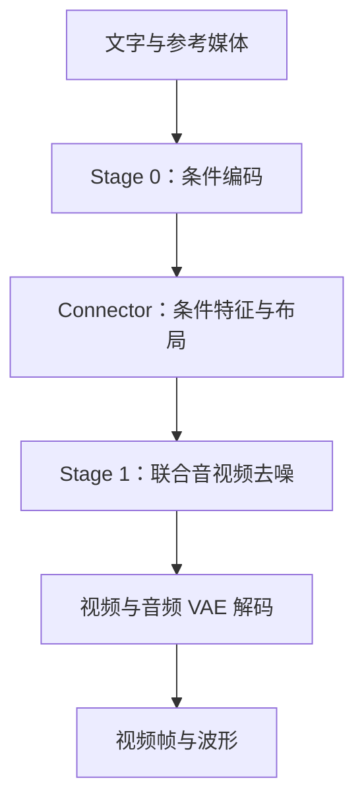

# MiniMax H3：文字、参考素材怎样一起变成有声视频

学完这一篇，你应当能回答三个问题：H3 为什么既有语言模型又有扩散模型？视频和声音怎样一起生成？贡献 Omni 时，哪些优化可以复用结果，哪些会改变画面或声音？

不要求你先读懂 Transformer 源码。先记住三个词：**条件**告诉模型要生成什么，**latent（潜变量）**是压缩后的媒体表示，**去噪**是从随机数逐步构造内容的计算过程。

!!! info "阅读坐标与证据边界"
    本篇核对日期为 2026-10-15。工程分析固定在 vLLM-Omni 快照 `910b8f07d23c7f387729173333c9d5f927dc6c4f`，文末提供源码链接。模型能力以 MiniMax 官方模型卡为补充；默认配置、可选实现与实机性能是不同层次。本篇没有执行权重推理或测量加速比。

## 1. 先用一个小任务理解 H3

设想你想生成这样的片段：

> 一个女孩在厨房打碎了玻璃杯，镜头跟随她的手，能听见碎裂声和她的惊呼。

这里至少有四种约束：

- 视觉外观：女孩、厨房、玻璃杯的样子。
- 时间顺序：拿杯子、失手、杯子落地。
- 物理声音：玻璃破碎发生在落地附近。
- 表演：惊呼、动作与情绪相互呼应。

如果先生成无声视频，再独立生成一段音频，两个系统需要额外解决对齐问题。
H3 的 Base 生成器则在同一次迭代中处理视频与音频 latent，让两种模态的信息可以交换。
**联合建模提供对齐的能力，但并不保证每一次生成都严格遵守物理或语言要求。**

它也不是把文字 token 逐个翻译成视频帧。
视频中的多个位置与声音中的多个位置，会随着去噪轮次一起更新。

### 1.1 三种输入模式，不等于三种完全不同的基础模型

官方开源 checkpoint 分成两个任务家族：

- **FL2VA**：支持文字生成音视频，也支持首帧、尾帧或首尾帧作为条件。
- **Ref2VA**：支持参考图像、视频与音频，将素材作为生成上下文。

T2VA 表示 Text to Video and Audio。
FL2VA 中的 F/L 表示 First/Last frame。
Ref2VA 则表示 Reference to Video and Audio。

参考图像给出的可能是外观线索，参考音频给出的可能是音色或声音线索。
“作为参考”与“逐样本复制”不是同一个约束；具体行为还取决于请求所表达的任务、掩码以及输入处理。
官方给出的输入输出范围见 [MiniMax H3 模型卡](https://huggingface.co/MiniMaxAI/MiniMax-H3)。

## 2. 先分清产品系统、模型结构与部署 Stage

这是最容易混淆的地方。

**完整 H3 系统**包括提示与上下文整理、H3-Base 生成，以及面向 2K 输出的再生成模块。
官方说明中，H3-Context-IR 与 H3-Regenerate-2K 不是都随 Base 权重一起开源。
所以“本地跑起 H3-Base”不能直接等同于复现完整线上 2K 工作流。
来源：[官方 H3 仓库](https://github.com/MiniMax-AI/MiniMax-H3)。

**Base 的内部组件**包括文本编码器、Visual VAE、Audio VAE 和联合音视频 Transformer。
其中 VAE 负责媒体与 latent 之间的变换。
文本编码器负责把提示转换成条件特征。
Transformer 负责在条件引导下迭代生成 latent。

**Omni 的 Stage**则是为了调度和部署而划分的执行边界。
本快照默认的 H3 拆分为两个 Stage：



图中 VAE 解码在默认两阶段拓扑中属于 Stage 1 的执行链。
可选 `minimax_h3_disaggregated_decode` 拓扑会进一步把 VAE decode 拆成 Stage 2。
这不是“换了第三个生成模型”，而是改变组件放在哪里执行。

!!! note "LLM_AR 是执行接口，不是生成算法的结论"
    `pipeline.py` 把 Stage 0 登记为 `LLM_AR`，同时把 `max_tokens` 限制为 1，并输出 latent payload。
    这里复用了 LLM runner 的加载与调度入口；不能据此推出“编码阶段逐 token 生成视频”。
    看一个 Stage 做什么，应当结合模型类、输入处理器和输出类型。

## 3. 把图像和声音装进模型：latent 与 token

### 3.1 为什么不直接在原始像素上计算注意力

一段视频有时间、宽、高与颜色通道。
例如，把每一帧的每个像素都当成 token，会产生非常长的序列。
标准全注意力的配对数量随 token 数量的平方增长。

如果序列长度从 $N$ 变为 $2N$，注意力配对从 $N^2$ 变成约 $4N^2$。
这还没算层数、head 数量以及中间激活。
因此第一步通常是压缩媒体，而不是立即堆更多 GPU。

VAE 可以类比为一种“适合生成模型操作的媒体压缩格式”。
这个比喻仅用于理解：它不是 JPEG，latent 也不是人类能直接观看的缩略图。
解码器必须把 latent 还原为像素或波形。

### 3.2 视频 latent 怎样变成 Transformer 序列

`packed_tokens.py` 的视频入口接收：

```text
[B, C, T, H, W]
 batch  latent通道  时间  latent高  latent宽
```

这里的 $H,W$ 已经是 latent 空间尺寸，不是输出视频的像素分辨率。
模型再以 `(1, 2, 2)` 的 patch 切分 latent。
每个 patch 含 $1\times2\times2$ 个 latent 位置。

假设 $B=1$，且 latent 形状为 `[1, 24, 7, 48, 80]`，则：

$$
N_v=7\times(48/2)\times(80/2)=6720
$$

每个 patch 展平后的宽度为：

$$
D_{patch}=24\times1\times2\times2=96
$$

所以 patchify 的结果是 `[6720, 96]`。
输入投影再将这些向量映射到 Transformer 的工作宽度。
这是一个用于理解排布的假设尺寸，不是服务的固定分辨率。

`unpatchify` 要执行相反过程，恢复时间和空间排列。
只保证元素数量相等还不够；如果 transpose 次序错了，输出画面仍会错位。

### 3.3 音频 latent 与视频帧率不是一回事

H3 的音频 latent 时间网格是 40 Hz。
10 秒对应约 $10\times40=400$ 个时间位置。
立体声左右声道在编码与解码时分别处理，再组合成双声道结果。
打包函数把 `[audio_channel, latent_dim, T]` 转换成行序列。
40 Hz 是每声道的时间网格；10 秒双声道形状 `[2, D, 400]` 会打包成 `[800, D]`，合计 800 行音频 token。
不能把两个声道合计的 token 数误算成 400。

因此，音频的一个 token 不等于视频的一帧。
联合模型依靠时间坐标与布局信息，让不同采样网格上的内容在时间上对应。
不要为了“对齐”而直接把音频 latent 长度强行改成视频帧数。

## 4. H3-Omni-Transformer 到底联合了什么

用最简化的形式写，一次模型计算为：

$$
(v_v,v_a)=F_\theta(z_v,z_a,c,t_v,t_a,\text{layout})
$$

- $z_v,z_a$：当前轮的视频、音频 latent。
- $c$：编码后的文本与参考条件。
- $t_v,t_a$：两个模态的生成进度。
- `layout`：哪些 token 属于哪种模态、哪些位置是条件、哪些位置要更新。
- $v_v,v_a$：模型预测的更新方向，而非最终的像素和波形。

工程默认架构配置包含 50 个主层、hidden size 5376、56 个注意力头，以及 2 个 token refiner 层。
实际加载时应以 checkpoint 配置解析结果为准，不能把 dataclass 默认值当成所有变体的硬约束。

所谓 **single-stream**，重点是不同模态进入共享 Transformer 主干进行信息交互。
它不意味着所有模态使用相同的原始输入格式。
视频和音频仍然需要各自的输入输出投影与调制。

### 4.1 AdaLN：给同一套积木不同的操作指令

LayerNorm/RMSNorm 会调整特征的尺度。
AdaLN 进一步根据生成进度、模态等条件，给特征施加不同调制。
概念上可以写成：

$$
y=\gamma(t,m)\odot \operatorname{Norm}(h)+\beta(t,m)
$$

$h$ 是当前 token 特征，$m$ 是模态条件。
$\gamma,\beta$ 是从条件计算出来的缩放和偏移。
实际 block 还包含门控与残差路径；公式用于说明“条件控制特征处理”这一件事。

可以把主干理解成共用的乐队，AdaLN 像不同声部收到的力度与节拍提示。
乐队共享，不代表各声部在同一时刻收到完全相同的指令。

### 4.2 位置编码：时间与空间都不能丢

视频既有“第几时刻”，也有“画面哪个位置”。
H3 使用三维多模态旋转位置表示来表达这些坐标。
打包后虽然 token 变成一维行序列，它原来的时间与空间位置仍然需要通过坐标传入模型。

“把 tensor 展平”是存储布局操作，不代表模型可以忘掉几何结构。
参考素材和生成目标也需要清晰的坐标与文档边界。
多请求打包时尤其不能让请求 A 看见请求 B 的 token。

## 5. 去噪计算：为什么要迭代，又为什么不套普通 KV Cache

### 5.1 从随机数走到目标 latent

把“从噪声走向内容”写成一个教学用的直线路径：

$$
z_t=(1-t)\epsilon+t x,\qquad 0\le t\le1
$$

$\epsilon$ 是噪声，$x$ 是干净 latent。
$t=0$ 表示起点，$t=1$ 表示目标。
理想方向为 $v=x-\epsilon$。
因此可由当前点和方向估计终点：

$$
\hat{x}=z_t+(1-t)v_\theta(z_t,t,c)
$$

快照中的 `minimax_h3_rf_v_to_x0` 使用了这一时间约定。
求解器再根据当前与下一 sigma，将状态推进一小步。
注意 `sigma=1-t`；读源码时混用二者，会把前进方向看反。

### 5.2 一步更新两个模态，保留条件位置

`minimax_h3_denoise_loop` 的核心顺序是：

1. 取本轮视频与音频 sigma，准备对应 timestep。
2. 组装 latent、参考条件与 update mask。
3. 调一次联合模型，得到两个模态的方向。
4. 分别更新视频和音频目标位置。
5. 将被固定的参考位置恢复到条件锚点，再进入下一轮。

这解释了“参考首帧为什么不会被当作普通目标一直自由改写”。
掩码决定哪些位置能够更新；参考条件的噪声处理也有单独逻辑。
它不是把输入图片简单拼在最终视频前面。

### 5.3 H3 的这条路径不是每步双分支 CFG

普通 CFG 常见做法是同时算有条件和无条件结果，再做差放大。
但这份 H3 去噪代码只支持 **CFG-distilled checkpoint**，使用 positive 分支的原始预测。
不能直接照搬另一个扩散模型的“双倍 CFG batch”优化教程。

蒸馏把一部分指导行为放进了训练后的权重。
因此减少条件分支与“运行时偷偷跳过无条件分支”是两回事。
少步 Turbo 配置也必须配套适用权重与调度，不应仅把任意模型的步数从 50 改到 5。

### 5.4 普通 AR KV Cache 为什么不直接适用

自回归文字模型生成下一个 token 时，已生成前缀不再改变。
此前缀的 K/V 可以复用。
H3 的目标 latent 在每轮都改变，目标位置的表示以及后续层 K/V 随之改变。
因此不能把上一轮所有 K/V 直接当作这一轮结果。

正确问题应当是：“这段计算的所有输入是否真的没变？”
AdaLN 投影缓存正是沿着这个问题寻找可复用子计算。

## 6. 一次请求怎样经过 Omni

先看 Stage 0：

- `prepare_encoder_prompt` 整理请求。
- `MiniMaxH3Encoder` 执行文本与参考媒体编码。
- `encoder2diffusion_full_payload` 输出后续需要的条件与元数据。

再看 Stage 1：

- `encoder2diffusion` 将 payload 变成 diffusion 输入。
- pipeline 根据时长、尺寸规划 latent 与时间表。
- denoise loop 生成音视频 latent。
- VAE decoder 生成视频帧和音频波形。

Connector 传递的是编码结果与布局，而不是“整个视频的 AR KV Cache”。
两阶段配置中 `need_recv_cache=False` 也说明不要将它误认成普通 LLM 的 KV 迁移。
最终封装成播放器可播放的媒体，还涉及输出与编码路径。

### 6.1 帧数为什么有时向上对齐

`time_request.py` 将视频帧数向上对齐到 $17k+5$。
对应的视频 latent 时间长度为 $5k+2$。
例如请求 300 帧，规划会对齐到 311 帧：

$$
300\longrightarrow311=17\times18+5\longrightarrow92=5\times18+2
$$

尾部补齐使用重复末帧来满足编码块约束；它不意味着把视频开头循环了一遍。
对交付时长敏感时，需要同时核对请求帧数、内部对齐帧数和最终输出裁剪。
帧数对齐解释张量长度，不能单独解释角色漂移、首尾重复或声音错误。

## 7. 推理优化：按省下什么来分类

### 7.1 已实现：精确 AdaLN 投影缓存

`adaln_cache.py` 缓存的是相同输入、相同权重下的调制投影输出。
对于固定时间表，不同请求可能重复使用同一组 timestep embedding。
无需反复做相同大矩阵投影，就能减少该子图的计算。

这不是“上一轮差不多，所以拿来凑一下”。
缓存身份必须包含相关输入与权重；换 LoRA、精度或调度，旧结果可能失效。
运行时缓存与预计算 sidecar 也有不同的生命周期和校验要求。
本快照提供可选 offload 路径，但不能理解成默认无条件删除所有 AdaLN 权重。

### 7.2 已实现：张量并行与序列并行

TP 将线性层等计算按参数维度分到不同设备。
Ulysses/Ring 类序列并行则围绕长 token 序列拆分注意力计算。
它们解决的瓶颈不同，也都需要设备间通信。

默认部署样例让 Stage 0 使用两张卡，Stage 1 使用四张卡与 Ulysses degree 4。
这是该文件的资源安排，**不是模型最小硬件要求**。
可选三阶段拆分还会改变解码资源与传输成本。

### 7.3 已实现：减少 VAE 中间内存

`vae_temporal.py` 将尾帧 padding 移入尾块，避免为了少量尾部补齐复制整段视频。
解码时还可以尽早写入 uint8 输出，减少长期保留浮点视频缓冲区的开销。

这类优化省的是峰值内存与拷贝，不代表主 Transformer 的 FLOPs 下降。
长视频中，VAE 的峰值显存可能决定请求能否完成，即使它不是最耗时组件。

### 7.4 条件实现与候选：要看后端、模式和精度边界

快照包含多种注意力后端、量化与缓存集成入口。
“存在类或文件”不等于目标设备、参考模式、序列并行组合都已经启用。
若考虑稀疏注意力或近似跨步缓存，应单独标明它们可能改变计算与生成结果。

本篇不把官方未来规划、仓库可选入口或理论复杂度写成已测加速比。
实测时应固定 checkpoint、输入、seed、调度、分辨率、时长与并行配置，再一次改变一个选项。
至少同时检查耗时、显存、音画对齐、参考一致性与最终实际帧数。

## 8. 给准备贡献 Omni 的你：先改哪个接口

如果参考图片没有进入模型，沿输入处理器、编码器和 payload 检查，不要先改 DiT。
如果图像正确但声音缺失，先检查音频 latent、解码输出与媒体封装边界。
如果增加并发后出现素材串用，先检查请求边界、布局和缓存生命周期。
如果只在长片段 OOM，把条件编码、去噪、VAE 三段峰值分别记录。

这些定位方法建立在一个原则上：**先找错误第一次出现的表示，再决定改哪一层。**
HTTP 成功或进度条走完不能证明输出质量通过。
实际观看、听音频和核对时长，是生成服务验收的一部分。

## 9. 源码阅读路线

以下链接固定在本篇分析 SHA，避免 main 更新后读到不同实现：

1. [pipeline.py：两个 Stage 与可选独立 decoder](https://github.com/vllm-project/vllm-omni/blob/910b8f07d23c7f387729173333c9d5f927dc6c4f/vllm_omni/model_executor/models/minimax_h3/pipeline.py)。先看输入输出与 execution type。
2. [encoder.py：MiniMaxH3Encoder](https://github.com/vllm-project/vllm-omni/blob/910b8f07d23c7f387729173333c9d5f927dc6c4f/vllm_omni/model_executor/models/minimax_h3/encoder.py)。看条件如何计算。
3. [packed_tokens.py：patchify 与音频打包](https://github.com/vllm-project/vllm-omni/blob/910b8f07d23c7f387729173333c9d5f927dc6c4f/vllm_omni/diffusion/models/minimax_h3/packed_tokens.py)。手算一次形状。
4. [minimax_h3_transformer.py：结构与并行层](https://github.com/vllm-project/vllm-omni/blob/910b8f07d23c7f387729173333c9d5f927dc6c4f/vllm_omni/diffusion/models/minimax_h3/minimax_h3_transformer.py)。看输入投影、主层与输出投影。
5. [denoise_loop.py：生成主循环](https://github.com/vllm-project/vllm-omni/blob/910b8f07d23c7f387729173333c9d5f927dc6c4f/vllm_omni/diffusion/models/minimax_h3/denoise_loop.py)。跟踪一轮更新与 mask。
6. [time_request.py：帧数与时间表](https://github.com/vllm-project/vllm-omni/blob/910b8f07d23c7f387729173333c9d5f927dc6c4f/vllm_omni/diffusion/models/minimax_h3/time_request.py)。解释 300→311。
7. [adaln_cache.py：精确投影缓存](https://github.com/vllm-project/vllm-omni/blob/910b8f07d23c7f387729173333c9d5f927dc6c4f/vllm_omni/diffusion/models/minimax_h3/adaln_cache.py) 与 [vae_temporal.py：内存优化](https://github.com/vllm-project/vllm-omni/blob/910b8f07d23c7f387729173333c9d5f927dc6c4f/vllm_omni/diffusion/models/minimax_h3/vae_temporal.py)。逐项判断优化是否改变数值。
8. [默认部署配置](https://github.com/vllm-project/vllm-omni/blob/910b8f07d23c7f387729173333c9d5f927dc6c4f/vllm_omni/deploy/minimax_h3_disaggregated.yaml)。最后才看卡数与参数。

## 10. 理解检查

**为什么 Stage 0 的 `LLM_AR` 不代表视频是自回归生成的？**
因为它是 runner 接口分类，实际任务由编码器类与 latent 输出决定；视频生成发生在 diffusion Stage。

**为什么上一轮的目标 token K/V 通常不能直接复用？**
目标 latent 每轮改变，K/V 的输入也随之改变。必须证明具体子计算输入不变才能缓存。

**为什么重复末帧补齐不能解释“开头又播放了一次”？**
因为补齐发生在末尾，对齐约束本身不复制开头。应继续检查素材内容、时间轴与输出裁剪。

**改成更少去噪步数，就必然是无损加速吗？**
不是。求解误差、蒸馏权重与时间表都影响结果；先核对模型与 schedule 是否匹配，再实际看和听。
