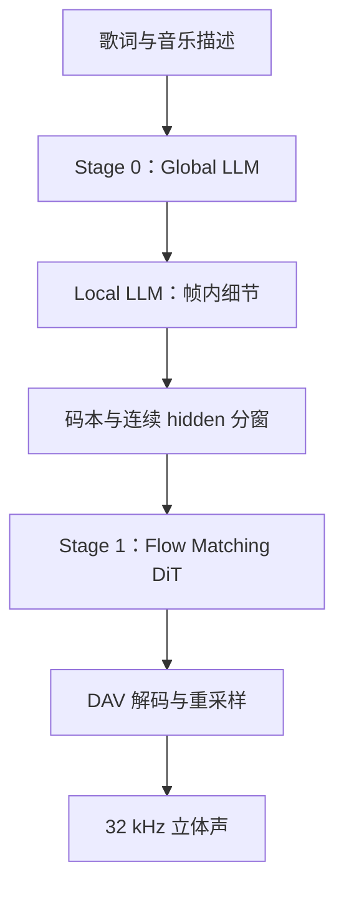

# MiniMax Music 3：从歌词到音乐，两个自回归方向与一条连续合成链

生成一首歌，需要同时决定“接下来唱什么”和“这一瞬间怎样发声”。
MiniMax Music 3 把这两个时间尺度拆开：大模型沿歌曲时间前进，小模型补充每个短时间片的细节，再由连续生成模块合成波形。

这篇教程从初学者视角解释这条链，重点是：**离散 token 用来组织生成，连续 hidden state 用来驱动音频合成；它们不是同一个东西。**

!!! info "阅读坐标与验证范围"
    本篇核对日期为 2026-10-15。Omni 工程实现固定在 `910b8f07d23c7f387729173333c9d5f927dc6c4f`。
    官方模型卡用于核对模型设计，具体调度、分块与优化以本快照源码为准。
    本篇未运行真实权重生成，也不报告实测性能。源码实现、部署默认值与官方框架支持范围分别说明。

## 0. 从 checkpoint 到模型结构：读真实层数与权重 shape

### 0.1 固定版本，而不是只读模型名称

本节核对官方仓库 `MiniMaxAI/MiniMax-Music3` 的固定 revision
[`fbdf52fbaaca799592917417eb05f1899f1255ec`](https://huggingface.co/MiniMaxAI/MiniMax-Music3/tree/fbdf52fbaaca799592917417eb05f1899f1255ec)。
我们实际读取 config JSON 和代表性 safetensors 的头部，没有下载大张量，也没有运行模型。
[精简证据记录](checkpoints/minimax-music3.json) 保存配置来源、参数名、shape 和存储 dtype。

下文 **[配置]** 指真实发布 JSON，**[头部]** 指实读 safetensors 元数据，**[推导]** 指据此计算的 forward 形状。
这三者都不等于实测推理性能。

```text
MiniMax-Music3/
├── config.json                         复合模型入口，不含全部结构参数
├── language_model/
│   ├── config.json                     Qwen3 Global backbone
│   ├── model-00001-of-00004.safetensors …
│   └── model.safetensors.index.json
├── rvq_depth_decoder/
│   ├── config.json                     Local depth decoder
│   └── diffusion_pytorch_model.safetensors
├── condition_encoder/config.json、diffusion_pytorch_model.safetensors
├── transformer/
│   ├── config.json                     声学Flow Matching DiT
│   ├── diffusion_pytorch_model-00001-of-00002.safetensors …
│   └── diffusion_pytorch_model.safetensors.index.json
├── vocoder/config.json、diffusion_pytorch_model.safetensors
└── tokenizer/、qwen_7B/ …
```

根 `config.json` 只声明复合架构与 `model_type`，不能从它直接得出所有组件的层数。
此版本同时保留 `qwen_7B/` 参考实现布局；Omni 的 Global 权重从 `language_model/` 加载，本文使用这套路径。
4 个 Global 分片与 2 个 DiT 分片是存储划分，分别不等于 4 层和 2 层网络。

三套 Transformer 的结构先并排看；具体配置来源与 shape 在后面逐项展开：

| 组件 | 层数 | hidden | Q / KV 头数 | head_dim | FFN 中间宽度 |
| --- | --- | --- | --- | --- | --- |
| Global | 36 | 4096 | 32 / 8 | 128 | 12288 |
| Local | 4 | 4096 | 16 / 16 | 256（推导） | 6144 |
| 声学 DiT | 36 | 2048（推导） | 32 / 32 | 64 | 8192 |

Local 的每头维度按 `4096/16` 推导；DiT 工作宽度按 `32×64` 推导。三者的层数、head_dim 与权重不能互换。

### 0.2 Global：36 层 Qwen3，先把 GQA 对上

[配置] `language_model/config.json` 的实际字段：

| 配置字段 | 实际值 |
| --- | --- |
| `num_hidden_layers` / `hidden_size` | 36 / 4096 |
| `num_attention_heads` / `num_key_value_heads` | 32 / 8 |
| `head_dim` / `intermediate_size` | 128 / 12288 |
| `vocab_size` / `max_position_embeddings` | 200000 / 10240 |

[头部] 代表性参数如下，前六项来自第 1 分片，最后一项来自第 4 分片：

```text
model.embed_tokens.weight                  [200000,4096] BF16
model.layers.0.self_attn.q_proj.weight      [4096,4096]   BF16
model.layers.0.self_attn.k_proj.weight      [1024,4096]   BF16
model.layers.0.self_attn.v_proj.weight      [1024,4096]   BF16
model.layers.0.mlp.gate_proj.weight         [12288,4096]  BF16
model.layers.0.mlp.down_proj.weight         [4096,12288]  BF16
lm_head.weight                             [200000,4096] BF16
```

[推导] token id `[B,L]` 查 embedding 后得到 `[B,L,4096]`。
一个 block 中 Q 变为 `[B,L,32,128]`，K/V 各为 `[B,L,8,128]`；这是 32Q/8KV 的 grouped-query attention。
SwiGLU MLP 的 gate/up 各投影到 12288，经门控后由 down projection 回到 4096。
最终 `lm_head` 从 `[B,4096]` 的当前状态产生 `[B,200000]` 的词表 logits。

但 `c0` 的合法音乐码只有 16384 项，**不能把整个 200000 词表都当成 c0 码本**。
模型 sampler 还要做特殊 token 处理、音乐码范围限制、CFG 和 top-k。
词表规模、某个子码本规模和最终声学维度，是三种不同概念。

### 0.3 Local：4 层，head_dim 为 256 而非 Global 的 128

[配置] `rvq_depth_decoder/config.json` 给出：

| 配置字段 | 实际值 |
| --- | --- |
| `num_layers` / `hidden_size` | 4 / 4096 |
| `num_attention_heads` / `intermediate_size` | 16 / 6144 |
| `max_position_embeddings` | 16 |
| `num_codebooks` / `audio_vocab_size` | 8 / 1024 |

此处没有单独的 `head_dim` 字段；按模块的 `hidden_size // num_heads` **推导**得到 $4096/16=256$。
Global 的 head_dim=128、Local 的 256 与后面 DiT 的 64，不能混用。

[头部] Local 单文件中读到：

```text
audio_embeddings.weight          [7168,4096] BF16
pos_embedding.weight             [16,4096]   BF16
layers.0.attn.to_q.weight         [4096,4096] BF16
layers.0.attn.to_k.weight         [4096,4096] BF16
layers.0.attn.to_v.weight         [4096,4096] BF16
layers.0.gate_proj.weight         [6144,4096] BF16
audio_heads.0.weight             [1024,4096] BF16
```

$7168=7\times1024$，表示后七个码本各自有 embedding 区间；不是第一个 16384 码本被缩小了。
7 个 `audio_heads.0` 到 `.6` 分别负责七个后续码本的 1024 类预测。
16 个位置 embedding 是帧内短序列的位置表，不是只能生成 16 帧音乐。

[推导] 对当前长度为 $K$ 的帧内序列，Local 输入是 `[B,K,4096]`。
Q/K/V 各为 `[B,K,16,256]`，注意力后仍回到 `[B,K,4096]`；当前码本 head 输出 `[B,1024]`。
$K$ 是当前一帧内部的已生成深度位置，歌曲时间长度则由 Global 的 $L$ 表示。

### 0.4 条件编码器：32768 不是直接塞进 2048 的黑盒

[配置] `condition_encoder/config.json` 给出 8 个 condition layers、每层 hidden 4096、输出 2048。
[头部] `layer_weight_logits=[8]`，`layer_scale=[1]`，`proj.weight=[2048,4096,3]`，均为 F32。

[推导] 一窗 hidden 输入 `[B,F,32768]`，其中 $32768=8\times4096$。
Omni 先重排为 `[B,8,4096,F]`，对 8 路 hidden 进行学习到的加权融合，再得到 `[B,4096,F]`。
随后 kernel size 3 的 Conv1d 投影到 `[B,2048,F]`，再对齐到声学 latent 的时间网格。
这解释了为什么“拼接了八路 hidden”不意味着后面每层都以 32768 作为 hidden size。

### 0.5 声学 DiT：另一个 36 层网络，不是再次运行 Qwen3

[配置] `transformer/config.json` 给出 `num_layers=36`、`num_attention_heads=32`、`attention_head_dim=64`、`ff_inner_dim=8192`、`condition_dim=2048`、`in_channels=128`。
因此其 attention 工作宽度 **推导**为 $32\times64=2048$。
它与 Global 恰好都为 36 层，但权重、输入和运算任务不同。

[头部] 第一个声学 DiT 分片包含：

```text
proj_in.weight                                [2048,2304]   F32
transformer_blocks.0.attn.to_q.weight           [2048,2048]   F32
transformer_blocks.0.ff_in.weight               [16384,2048]  F32
transformer_blocks.0.ff_out.weight              [2048,8192]   F32
```

$2304=128+128+2048$：当前 latent、一块同宽的零占位与对齐条件拼成输入。
`ff_in` 两半形成 value/gate，门控后宽度 8192，再由 `ff_out` 回到 2048。
因此 config 的 `in_channels=128` 指声学 latent 宽，不意味着 `proj_in` 的输入矩阵必须只有 128 列。

[推导] 200 帧窗口经时间对齐得到 689 个 latent 位置时：

```text
AR hidden                    [B,200,32768]
条件融合与对齐                 [B,2048,689]
当前声学latent                [B,128,689]
拼接与换轴                    [B,689,2304]
proj_in                      [B,689,2048]
前置1个timestep embedding     [B,690,2048]
36层DiT后移除时间位置           [B,689,2048]
声学速度输出                   [B,128,689]
```

拼接输入还会先经过 2304 通道的 `preprocess_conv` 与残差相加；输出投影后也有卷积与残差，均不改变时间长度。
690 而非 689 是这次主 Transformer 内部的序列长度，因为 timestep 作为一个前置位置参与注意力。
689 是该窗口声学 latent 长度的推导结果，不是所有请求固定的音频长度。
CFG 会进一步形成条件/无条件计算分支，所以上图的 $B$ 还要结合 solver 实际组批理解。

### 0.6 Vocoder 与权重加载：把矩阵送到正确位置

[配置] `vocoder/config.json` 给出 latent channels 128、decoder input 1024、hidden 1536、upsampling ratios `[8,8,4,2]`、内部采样率 44100。
[头部] `dec_in_proj.weight=[1024,64,1]`，不是 `[1024,128,1]`。
原因是立体声 128 通道先拆成两个 64 通道流，沿 batch 维一起解码：`[B,128,T] → [2B,64,T]`。
四段上采样乘积为 $8\times8\times4\times2=512$，对应每个 latent 位置生成 512 个内部波形采样。

加载时 Global 使用 vLLM `AutoWeightsLoader`，按 Qwen3 参数映射与 TP 分片规则装入。
Local 的 `attn.to_q/to_k/to_v` 在 `RVQDepthDecoder.load_checkpoint_state` 沿输出轴拼成 `[12288,4096]` 的融合 QKV，顺序为 Q、K、V。
声学 DiT 的 `remap_transformer_state` 同样把三份 `[2048,2048]` 拼成 `[6144,2048]`，并去掉 `to_out.0` 中表示列表的 `.0`。

Vocoder 原权重使用 `weight_g/weight_v` 参数化，加载完成后 `remove_weight_norm` 把它们折叠成推理需要的卷积权重。
例如转置卷积 `blocks.0.conv_t1.weight_v=[1536,768,16]` 的维度约定不同于 Linear，不能一律按 `[out,in]` 解读。
组件 loader 会核对缺失键与 shape；外部名字对上了，不代表可以忽略 QKV 顺序、FFN 两半的顺序或 stereo reshape。

## 1. 一个初学者容易误判的问题

给模型一段歌词：

```text
[Verse]
雨落在窗边
我想起昨天
[Chorus]
让风带我走远
```

再给音乐描述：

> 温暖的流行民谣，轻柔女声，主歌用木吉他，副歌加入鼓和弦乐，情绪逐渐展开。

歌词决定希望唱出的文字与段落线索。
描述决定风格、演唱方式、配器与发展方向。
但两者都不是严格的 MIDI 乐谱或强制执行的时间轴。
模型仍要自行决定旋律、节奏、时值与具体音色。

因此，“输出里出现了歌词”只证明了一部分任务。
你还需要判断它是否唱出旋律、段落是否自然、声音是否连贯，以及提示是否得到合理响应。
歌词被念出来而不是唱出来，不能靠 HTTP 成功或波形非静音来验收。

## 2. 先看整条生成链



官方将 Global LLM 描述为 Qwen3-8B 初始化的 8B 模型，将 Local LLM 描述为 0.6B 模型。
官方还说明合成路径采用 Global/Local 的连续隐藏状态融合，再经 Flow Matching 与 Flow-VAE 生成声音。
来源：[MiniMax Music 3 官方模型卡](https://huggingface.co/MiniMaxAI/MiniMax-Music3)。

在 Omni 中，这些组件被部署成两个 Stage：

- **Stage 0 / AR talker**：Global backbone 加 Local depth decoder，产生音频码和连续条件。
- **Stage 1 / acoustic decoder**：把连续条件变成声学 latent，再解码为波形。

Local LLM 虽然是第二个语言模型组件，却没有单独成为一个 Omni Stage。
Stage 是调度边界，模型组件是计算结构，两者不需要一一对应。

## 3. 音频帧、码本、采样点：三个不同单位

### 3.1 25 Hz 的帧不是 25 Hz 的声音

Music3 的 AR 时间网格是每秒 25 个音频帧。
每帧约表示 40 毫秒的音乐内容。
而输出波形采样率是 32 kHz，表示每秒每声道有 32000 个采样点。

因此一秒音乐包含：

- 25 个 AR 时间位置。
- 每个位置 8 个码本值。
- 输出端每声道 32000 个波形采样点。

不能把“生成了 25 个 token”理解成“输出只有 25 个声音采样”。
这些 token 是压缩的符号表示，需要合成系统才能变成连续声音。

### 3.2 一个时间帧为什么有八个码

RVQ 是 Residual Vector Quantization，中文可理解为残差向量量化。
先用第一个码本表示主要信息，再用后续码本补上前面没有表示好的部分。

用一个简化的编码示意：

$$
r_0=x,\quad q_i=Q_i(r_i),\quad r_{i+1}=r_i-q_i
$$

$x$ 是待表示的特征，$Q_i$ 从第 $i$ 个码本中选择一个向量。
$r_i$ 是尚未解释的残差。
最终可用各级向量之和近似原特征。

这个公式解释“残差”一词，并不意味着推理时必须重新执行训练用 tokenizer。
当前生成器直接预测码本 ID，而音频合成又使用 LLM hidden state。

本 checkpoint 的每帧表示为：

```text
frame t = [c0, c1, c2, c3, c4, c5, c6, c7]
```

`c0` 的词表有 16384 项，其他七级各有 1024 项。
这些是不同码本中的索引，不能把 `c2=10` 和 `c5=10` 当成同一个声学向量。

### 3.3 “像写总谱，再补配器”只是比喻

可以把 `c0` 类比为较粗的音乐规划，后七级类比为进一步补充质感。
但 `c0` 不是人类可读的曲谱，后七级也不对应七件固定乐器。
每一级是训练得到的表示，不能把它们硬解释成“人声、鼓、贝斯……”八条独立音轨。

## 4. 两个自回归方向：时间轴与码本深度

### 4.1 Global LLM 沿时间走

大模型看到文字条件以及之前生成的音乐帧，预测下一帧的首个码 `c0`。
其 hidden state 还会供 Local LLM 与后面的合成模块使用。

为什么用大模型处理时间？
因为歌曲的主歌、副歌、主题重复与情绪发展需要跨越很多短音频帧。
如果所有决策都只看几十毫秒的局部信息，整首歌就很难维持结构。

### 4.2 Local LLM 在一帧内走七步

拿到该帧 Global hidden 与 `c0` 后，depth decoder 依次预测 `c1` 到 `c7`。
代码中的 Local 模型是四层 causal Transformer。
其输入序列会从短到长增长，包含 Global hidden 投影与已生成码的 embedding。

```text
时间帧 t：
Global hidden → c0
              ↓
Local：c1 → c2 → c3 → c4 → c5 → c6 → c7
              ↓
整帧 embedding 反馈给 Global，推进到时间帧 t+1
```

“深度”指码本级别，不是音频时间长度，也不是把 Transformer 从四层变成七层。
每一步都复用同一组 Local 模型权重，预测不同级别的码。

### 4.3 为什么这样能少用大模型

如果把 8 个码全部串在一条序列中，并且每个码都调用 Global 模型，长度为 $F$ 帧的音乐需要约 $8F$ 次大模型 decode。
分层后，Global 只沿时间做约 $F$ 步，剩余帧内决策交给较小的 Local 模型。

对 30 秒音乐：

$$
F=30\times25=750
$$

概念上的“所有码都走 Global”是约 6000 个大模型时间步。
实际分层路径是约 750 个 Global 时间步，以及每帧内部的七级 Local 推理。

**这不等于整体加速八倍。**
Local 仍要算，CFG 有成对分支，后端还要合成音频，注意力长度、prefill 和调度成本也不同。
这个比较解释的是“计算职责如何转移”，不是 benchmark。

### 4.4 概率分解揭示了依赖关系

用 $c$ 表示文字条件，$C_{<t}$ 表示历史帧，可以概念性写成：

$$
p(C\mid c)=\prod_t\left[p(c_{t,0}\mid C_{<t},c)
\prod_{j=1}^{7}p(c_{t,j}\mid c_{t,<j},h_t,c)\right]
$$

$h_t$ 是 Global 在帧 $t$ 的状态。
这个式子说明：不能任意并行生成所有未来时间帧，也不能无条件把七级 depth 一次独立采样。
前后依赖正是生成一致性的来源，同时也是延迟约束。

## 5. 关键细节：合成用的是 hidden，不是只拿码去查表

`talker.py` 将一帧的 Global hidden 与七个 Local hidden 拼接。
每个宽度为 4096，所以一帧合成条件宽度为：

$$
D_h=8\times4096=32768
$$

200 帧的窗口，在按 `[F,D_h]` 理解时，包含 `[200,32768]` 的连续条件。
实际函数还会添加 batch 维与进行 transpose。

为什么不只把八个离散码直接送到一个固定 codec decoder？
因为选中某个离散 ID 后，hidden 中仍保留了比这个 ID 更丰富的上下文信息。
后续合成器可以使用这些连续信息来建模发音、音色、纹理与连续性。

因此保存了所有码，不代表已经保存了当前合成路径所需的所有内容。
修改跨 Stage payload 时，误删 hidden 或改错顺序，会导致合成条件损坏。
也不能把 Music3 的 acoustic Stage 直接换成另一个模型的 Code2Wav。
接口里都叫“音频码”，不代表 checkpoint 的表示契约相同。

## 6. 声学 Stage：先对齐网格，再从噪声合成 latent

### 6.1 25 Hz 条件怎样对齐到 DAV 的 latent

AR 每秒 25 帧。
DAV 的内部 latent 网格来自 44.1 kHz 与每帧 512 个样本的 hop。
因此内部 latent 每秒约有：

$$
f_l=44100/512\approx86.13
$$

把声学 latent 的每秒帧数除以 AR 的每秒帧数，便得到每个 AR 帧对应多少 latent 位置：

$$
\rho=\frac{44100/512}{25}=3.4453125.
$$

源码也把 25 Hz 写成 `24000/960`，因此使用了下面这个等价表达式。
其中 24000 与 960 描述的是条件帧网格，不是把最终输出改成 24 kHz：

$$
\rho=(44100/24000)\times(960/512)=3.4453125
$$

`dit.py` 先投影 hidden，再用最近邻插值对齐到目标长度。
例如 200 个 AR 帧对应 `int(200×3.4453125)=689` 个 latent 时间位置。
这一步是对齐计算网格，不是把音乐播放速度加快 3.445 倍。

### 6.2 Flow Matching DiT 在求解什么

DiT 接收当前声学 latent、连续条件与生成时间，预测一个速度场。
可用简化 ODE 形式表示：

$$
\frac{dx_t}{dt}=v_\theta(x_t,t,H)
$$

$H$ 是对齐后的音乐条件，$\theta$ 是模型参数，$t$ 是生成过程时间，$x_t$ 是这一时刻的声学 latent。
随着 $t$ 推进，$x_t$ 从噪声逐步走向可解码 latent。
数值求解器用离散步近似这条连续路径。
本快照 acoustic 默认是 30 步，latent 通道数为 128。

最后 DAV vocoder 把 latent 变成内部 44.1 kHz 立体声，再由重采样器输出 32 kHz。
所以不能因为最终 WAV 是 32 kHz，就把内部时间网格常量也改为 32000。
代码中的内部采样率、latent hop 与输出采样率各司其职。

### 6.3 两个 Stage 都有 CFG，但作用对象不同

CFG 是 Classifier-Free Guidance。
先求有条件与无条件预测，再放大二者之间与条件有关的差异。
通用写法为：

$$
f_{guided}=f_{uncond}+s(f_{cond}-f_{uncond})
$$

AR Stage 在 logits 上做引导，默认 scale 为 1.5，并结合 top-k 采样。
它把每个用户请求展开为 cond/uncond 两行，而且两行必须成对前进。
Acoustic Stage 则在速度预测上做引导，默认 scale 为 1.7，无条件支路使用清零的条件张量。

这不是把两个 Stage 的 scale 相加，也不是两次独立生成后混音。
具体 sampler 还处理词表范围、截断与确定性随机数，不能只用上述公式替换全部实现。

## 7. 流式：为什么要 200 帧窗口、100 帧步长

如果等整首歌生成完成再合成音频，用户等待首个声音的时间会很长。
本快照支持将 AR 输出切成重叠窗口，边生成后续条件，边解码已有条件。

```text
窗口 0：帧   0 ───────── 200
窗口 1：帧       100 ───────── 300
窗口 2：帧             200 ───────── 400
```

窗口覆盖约 8 秒内容，每次推进约 4 秒。
“第一窗覆盖 8 秒音乐”不等于“首包延迟就是 8 秒墙钟时间”。
首包延迟取决于计算速度、prefill、排队和 acoustic 求解，还涉及窗口实际输出的裁剪。

后一窗会携带前窗的一部分 latent 作为条件，并在每个求解步重新施加该条件。
解码后要按统一的整数边界裁剪重叠部分，再拼接波形。
**窗口不是简单各自产生 8 秒，再把全部结果直接首尾连接。**

`chunking.py` 的窗口几何与裁剪共同构成契约。
随便把窗口改为更短，看似能减少首包等待，却可能改变边界声音、长度与参考行为。
重采样器也要跨窗保留状态，不能每一块都当成一段独立音频重新初始化。

!!! note "官方发布路径与此处工程实现有区别"
    核对时，官方模型卡的限制段写着当前只支持非流式生成。
    本文的异步分窗指固定 vLLM-Omni 快照中的实现，不把它表述成所有官方框架的统一能力。

## 8. 两类状态：KV Cache 与音频窗口状态

Global LLM 沿时间因果生成，历史帧不再改变，因此能使用常规 AR KV Cache。
Local depth 序列最多只有少量位置，本快照直接使用 dense causal 计算，没有给它建立长序列 KV Cache。
它避免的是短序列场景下额外的管理成本，不代表 Local 没有自回归依赖。

Acoustic Stage 不沿歌曲时间执行普通文字 decode，也没有 vLLM attention KV Cache。
但它仍然保存请求状态，包括上个窗口 latent、条件、窗口索引与重采样状态。
这些状态按 request id 归属，完成或取消请求后必须清理。

“这个 Stage 没 KV”与“这个 Stage 无状态”是两件完全不同的事。
修改调度器时，如果把等待下一块的请求当作完全不占资源，就可能超额接收请求或释放过早。
本快照用 `retains_state_across_chunks=True` 表达 acoustic 的这种状态所有权。

## 9. 推理优化：已有机制、代价与候选

### 9.1 已实现：Global decode CUDA Graph

短 batch 的逐帧 decode 包含许多小 kernel。
CUDA Graph 记录固定形状与地址上的执行，减少每帧由 Python/CPU 重复发起工作的成本。
它并没有减少模型层数，也没有消除历史 KV 读取。

帧反馈必须使用固定地址的缓冲区，采样时的行号与请求映射则要在 replay 之外更新。
否则 graph 重放绕过 Python forward 后，可能把上一轮的元数据用于新的请求。
默认配置采用 `FULL_DECODE_ONLY`，prefill 和混合步仍有 eager 路径。

### 9.2 已实现：Local depth loop CUDA Graph

七次短序列 Local forward 也容易被 launch 开销主导。
`depth_graph.py` 按实际 CFG pair 数量缓存 graph，先预热再捕获。
这里没有随意把不同 pair 数量 padding 到同一个图，以便保留该形状对应的数值路径。

源码注释中的历史测量不是本篇当前环境的结果，因此不作为教程的性能承诺。
要验证，应分别测 Global、Local、声学 Stage 与端到端首包/整歌耗时。

### 9.3 已实现：分 Stage 并行与重叠窗口

将 AR 与 acoustic 放在不同设备，可以让不同组件在合适资源上执行，并给流水重叠创造条件。
但会增加跨 Stage 数据传输，尤其是较宽的连续 hidden。
当某一 Stage 明显较慢，另一 Stage 的空闲时间不会因“拆开了”就自动消失。

默认单卡部署文件面向 140 GB 卡；另有两 GPU 配置。
它们是资源预算样例，不代表模型的理论最小显存，更不代表任意 24 GB 卡都能直接复用这套参数。

### 9.4 已实现：声学 FP32 与 TF32 后端设置

acoustic 默认使用 float32，并在 CUDA 后端设置允许 TF32 的矩阵计算策略。
代码支持 bfloat16，但实现注释明确提醒它可能影响求解质量。
因此不能为了“统一 dtype”把 AR 的 BF16 直接复制给整个声学链。

TF32 设置也不是所有浮点运算都变成了同一种精度。
要比较精度，需要固定随机性、检查实际后端，并实际听发音、伴奏和窗口接缝。

### 9.5 候选：量化、缩短窗口、改求解器

这些方向可能降低显存或延迟，但本篇没有验证其在此 checkpoint 的收益与质量：

- Global/Local 量化可能改变采样 logits，一次码选择变化会影响后续整段音乐。
- 减少 DiT 步数改变数值求解精度，不能假设自动无损。
- 缩短窗口改变训练/推理条件与拼接契约，需要重做长度与听感检查。

优化试验应一次只改一个变量，并同时记录延迟、显存、实际时长与主观听感。
仅固定 seed 仍不足以保证跨精度、跨 attention kernel 的歌曲逐样本相同。

## 10. 长歌预算：帧上限不等于可用时长保证

本快照 `MAX_AUDIO_FRAMES=9000`，按 25 Hz 换算是 360 秒的工程帧上限。
官方模型卡开篇描述完整歌曲能力为最长五分钟，限制段同时列出 9000 帧。
这里保留两个事实，不把内部上限当成稳定六分钟成歌承诺。

Global 模型上下文上限为 10240，prompt 上限为 5000 token。
文字与生成的时间位置共享上下文预算，不能分别把两个上限同时用满。
粗略预算可以写成：

$$
F\lesssim\min(9000,10240-P-\text{special-token overhead})
$$

$P$ 是实际 prompt token 数量，完整计算还要跟随 prompt 构造与结束标记。
因此很长的 Caption 会挤占最长音乐的空间。
它不是越长越精确的免费控制通道。

## 11. 初学者的源码路线与小练习

所有工程链接固定于本篇 SHA：

1. [pipeline.py](https://github.com/vllm-project/vllm-omni/blob/910b8f07d23c7f387729173333c9d5f927dc6c4f/vllm_omni/model_executor/models/minimax_music3/pipeline.py)：先画两个 Stage 的输入输出。
2. [constants.py](https://github.com/vllm-project/vllm-omni/blob/910b8f07d23c7f387729173333c9d5f927dc6c4f/vllm_omni/model_executor/models/minimax_music3/constants.py)：核对帧率、码本、窗口与采样率。
3. [talker.py](https://github.com/vllm-project/vllm-omni/blob/910b8f07d23c7f387729173333c9d5f927dc6c4f/vllm_omni/model_executor/models/minimax_music3/talker.py)：从 `sample` 跟到整帧反馈和 hidden payload。
4. [rvq_decoder.py](https://github.com/vllm-project/vllm-omni/blob/910b8f07d23c7f387729173333c9d5f927dc6c4f/vllm_omni/model_executor/models/minimax_music3/rvq_decoder.py)：看 Local 层数、causal attention 与七个 head。
5. [dit.py](https://github.com/vllm-project/vllm-omni/blob/910b8f07d23c7f387729173333c9d5f927dc6c4f/vllm_omni/model_executor/models/minimax_music3/dit.py)：看条件对齐、CFG 与速度场求解。
6. [acoustic.py](https://github.com/vllm-project/vllm-omni/blob/910b8f07d23c7f387729173333c9d5f927dc6c4f/vllm_omni/model_executor/models/minimax_music3/acoustic.py) 与 [chunking.py](https://github.com/vllm-project/vllm-omni/blob/910b8f07d23c7f387729173333c9d5f927dc6c4f/vllm_omni/model_executor/models/minimax_music3/chunking.py)：跟踪一个窗口和请求结束的清理。
7. [depth_graph.py](https://github.com/vllm-project/vllm-omni/blob/910b8f07d23c7f387729173333c9d5f927dc6c4f/vllm_omni/model_executor/models/minimax_music3/depth_graph.py) 与 [部署配置](https://github.com/vllm-project/vllm-omni/blob/910b8f07d23c7f387729173333c9d5f927dc6c4f/vllm_omni/deploy/minimax_music3.yaml)：最后分析优化的启用条件。

**练习一：40 秒歌曲有多少 AR 帧、多少码本值？**
约 1000 帧、8000 个码本值；这不是 8000 次 Global decode，也不是波形采样点数量。

**练习二：为什么 8 个并发用户可能需要 16 行 AR 预算？**
因为 CFG 将一个用户请求展开为 cond/uncond 两行，两行需要成对调度。

**练习三：为什么只传离散码可能无法复现这里的声音？**
因为声学合成条件还包括 Global 与 Local 的连续 hidden，离散码不是完整接口。

**练习四：acoustic 无 KV Cache，取消请求时还要清理什么？**
跨窗 latent、条件、索引与重采样器状态；否则可能泄漏资源或影响后续请求。
