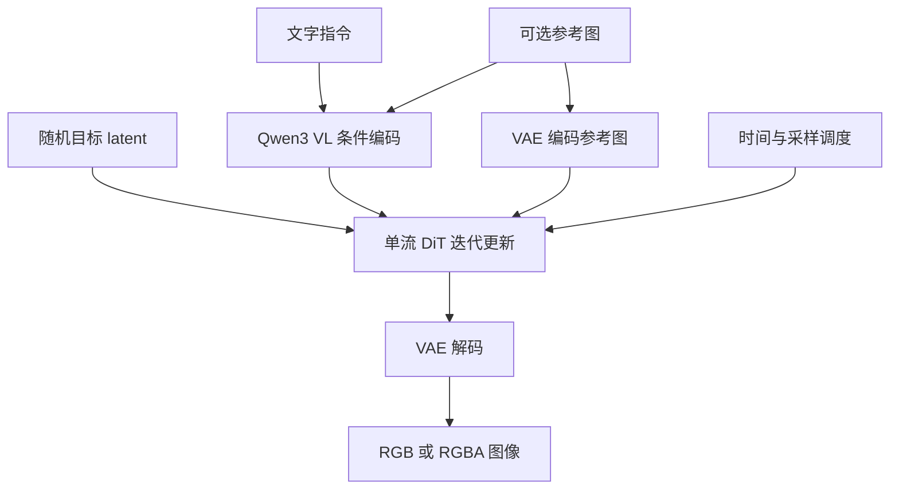

# Qwen-Image-2.1：从文字和参考图，到可编辑的透明图像

> 阅读目标：理解图像模型如何接收条件、如何迭代生成图像，以及为什么某些计算真的可以不重算。
>
> 源码阅读快照：vLLM-Omni `910b8f07d23c7f387729173333c9d5f927dc6c4f`，核对日期 2026-10-15。
> 本章完成的是官方资料与源码静态核对，没有运行本章模型的硬件性能或生成质量测试。

## 1. 先从一个具体任务出发

假设你有一张马克杯照片，希望模型完成：

> 保留杯子的形状，把杯身改成蓝色，印上“Learn Omni”，输出透明背景。

这个任务至少需要三类能力：

- 看懂指令：蓝色改在哪里，文字是什么，什么应该保留。
- 看懂参考图：杯子的轮廓、材质、视角和主体身份。
- 生成新图：修改内容，同时产生颜色与透明度。

Qwen-Image-2.1 把文生图与图像编辑放在一个模型框架里。
你可以只给文字，也可以同时提供参考图与文字。
官方还展示了多参考图、局部标注编辑和 RGBA 输出。
其中 RGBA 的 A 是 alpha，表示每个像素的不透明程度。
透明背景应当存在于这个通道里；画出棋盘格纹理不等于透明。

本章的模型标识是 **`Qwen/Qwen-Image-2.1`**。
它不是第一代 `Qwen-Image`，也不是把 2.0 的配置换个名字。
官方另外发布了 `Qwen/Qwen-Image-2.1-Turbo`，阅读采样步数时必须区分权重版本。

模型能力与版本信息见 [官方模型卡](https://huggingface.co/Qwen/Qwen-Image-2.1) 和 [官方项目](https://github.com/QwenLM/Qwen-Image-2.1)。

## 2. 三个角色：读任务、在草稿上画图、输出像素

把整个系统想成一个设计工作室：

1. **条件编码器**读懂客户要求，把文字和参考图转成计算机可用的向量。
2. **生成 Transformer**在压缩的草稿空间里不断修改画面。
3. **VAE 解码器**把完成的草稿还原成真正的像素。



注意参考图走了两条路径。
VLM 路径提供理解图像的条件表示；VAE 路径提供图像在生成空间中的表示。
同一张图被两种方式表示，不代表实现重复做了完全相同的工作。

### 2.1 官方结构信息与源码配置

官方项目的 Architecture 小节说明：

- 视觉生成部分约 7B 参数，采用 32 层 single-stream DiT。
- 条件编码器是 Qwen3-VL 8B，处理文字与参考图。
- VAE 使用 64 通道 latent，空间压缩倍率为 16，支持 RGBA。
- 采样采用 Flow Matching、Euler 离散调度与动态时间偏移。

**7B 指视觉生成组件，不是整条流水线的总参数量。**
显存预算还要考虑条件编码器、VAE、激活、KV cache 和执行工作区。
这些官方结构信息见 [官方 Architecture](https://github.com/QwenLM/Qwen-Image-2.1#architecture)。

### 2.2 先打开真实 checkpoint，而不是猜模型有多少层

本节固定的是 `Qwen/Qwen-Image-2.1` 的 Hugging Face revision：

```text
d26bb61231c349cf6b7896fa83353113880e1ba3
```

[固定版本文件树](https://huggingface.co/Qwen/Qwen-Image-2.1/tree/d26bb61231c349cf6b7896fa83353113880e1ba3) 中与结构直接相关的文件如下。
下面的树省略许可证、示例图片和部分 tokenizer 辅助文件，分片数与文件名来自该 revision 的实际列表。

```text
Qwen-Image-2.1/
├── model_index.json
├── transformer/
│   ├── config.json
│   ├── diffusion_pytorch_model.safetensors.index.json
│   ├── diffusion_pytorch_model-00001-of-00002.safetensors
│   └── diffusion_pytorch_model-00002-of-00002.safetensors
├── text_encoder/
│   ├── config.json
│   ├── generation_config.json
│   ├── model.safetensors.index.json
│   └── model-00001-of-00004.safetensors  …  model-00004-of-00004.safetensors
├── vae/
│   ├── config.json
│   └── diffusion_pytorch_model.safetensors
├── processor/
│   ├── tokenizer.json
│   ├── tokenizer_config.json
│   ├── preprocessor_config.json
│   └── video_preprocessor_config.json
└── scheduler/
    └── scheduler_config.json
```

先读 `model_index.json`，它给出了组件名与类的对应关系：
`transformer → QwenImage21Transformer2DModel`，`text_encoder → Qwen3VLForConditionalGeneration`，`vae → AutoencoderKLQwenImage21`。
另外两项是 `Qwen3VLProcessor` 与 `FlowMatchEulerDiscreteScheduler`。
processor 整理输入，scheduler 更新采样状态；它们没有这里列出的神经网络权重分片。

然后读 `*.safetensors.index.json`：它的 `weight_map` 把**每个参数名映射到所在分片**。
分成两个文件，不表示有两个 DiT；一个文件里也可能同时出现多层的参数。
配置回答“应该建什么网络”，索引回答“这块参数在哪个文件”，header 回答“文件实际声明的张量有多大”。

### 2.3 三套网络各有多少层、多宽

以下数值来自上述固定 revision 的 config；不是从 Omni 构造函数默认值倒推。
完整来源与精选 header 条目保存在 [checkpoint 核对记录](checkpoints/qwen-image-2-1.json)。
两个索引文件的真实参数名也分别覆盖 DiT block `0…31`、语言层 `0…35` 和视觉 block `0…26`，与下面的 32／36／27 层配置相互印证。

| Transformer 组件 | 层数 | hidden | Q / KV 头数 | head_dim | FFN 中间宽度 |
| --- | --- | --- | --- | --- | --- |
| 生成 DiT | 32 | 4096 | 32 / 32 | 128 | 12288 |
| Qwen3-VL 语言骨干 | 36 | 4096 | 32 / 8 | 128 | 12288 |
| Qwen3-VL 视觉骨干 | 27 | 1152 | 16 / 16 | 72 | 4304 |

`hidden` 是各位置的隐藏特征宽度；Q / KV 分别表示 query 头数与 key/value 头数。视觉骨干的 `head_dim=1152/16=72`、DiT 的 FFN 宽度 `4096×mlp_ratio(3)=12288` 是按实际配置推导，其余对应配置字段。
语言骨干使用 GQA，Q 投影输出 4096 维，K/V 各为 1024 维；生成 DiT 的 Q/K/V 则同宽。

| 组件接口 | 实际配置 |
| --- | --- |
| DiT latent 输入 / 输出通道 | 64 / 64 |
| DiT patch / 条件宽度 | `patch_size=1` / `context_in_dim=4096` |
| 视觉 patch / 时间 patch / 空间合并 | 16×16 / 2 / 2 |
| 视觉输出条件宽度 | 4096 |

`causal_condition=true` 是实际配置字段；`causal_block` 未写入这份 config，当前 Omni 构造函数默认补为 `True`。视觉 patch 与 DiT latent patch 属于不同网络，不要混为一谈。

VAE 使用卷积尺度级别描述结构，单独列出：

| VAE 字段 | 编码方向 | 解码方向 |
| --- | --- | --- |
| 图像通道 | 输入 RGBA：4 | 输出 RGBA：4 |
| latent 通道 | 64 | 64 |
| 基宽 | 96 | 144 |
| 空间 stage 数 | 5 | 5 |
| 各 stage 输出通道 | 96 → 192 → 384 → 768 → 768 | 1152 → 1152 → 576 → 288 → 144 |
| 每 stage 残差块数 | 2 | 3（`num_res_blocks+1`） |

`dim_mult=[1,2,4,8,8]`；解码入口先把 latent 投影到 1152 通道，末尾再输出 4 通道。
这里的 stage 是 VAE 内部尺度级别，既不是 Omni 进程数，也不代表整个 VAE 只有五层。
四次空间缩放得到 `16×` 压缩；config 同时有时间压缩 `8×`，静态图像只使用单帧轴，不据此把空间倍率改成 8。

[固定 DiT 配置](https://huggingface.co/Qwen/Qwen-Image-2.1/blob/d26bb61231c349cf6b7896fa83353113880e1ba3/transformer/config.json)、[Qwen3-VL 配置](https://huggingface.co/Qwen/Qwen-Image-2.1/blob/d26bb61231c349cf6b7896fa83353113880e1ba3/text_encoder/config.json)、[VAE 配置](https://huggingface.co/Qwen/Qwen-Image-2.1/blob/d26bb61231c349cf6b7896fa83353113880e1ba3/vae/config.json)。

### 2.4 只读权重 header，验证参数名和 shape

本次没有下载几十 GB 权重。对四个实际 safetensors 文件，先用 HTTP Range 读取前 `8` 字节的小端整数，获得 JSON header 长度，再仅读取对应 header 区间。
服务器均返回 `206 Partial Content`，读取的 header 与长度前缀总计 `112632` 字节，未读取 tensor 数据区。
因此以下是**真实文件声明的参数名、shape、存储 dtype**，不是随机初始化模型的 `state_dict` 推测；它不验证权重数值或推理质量。

DiT 第一分片中的代表参数：

```text
img_in.weight                                  [4096, 64]      BF16
transformer_blocks.0.attn.to_q.weight            [4096, 4096]    BF16
transformer_blocks.0.attn.to_k.weight            [4096, 4096]    BF16
transformer_blocks.0.attn.to_v.weight            [4096, 4096]    BF16
transformer_blocks.0.attn.to_out.0.weight        [4096, 4096]    BF16
transformer_blocks.0.img_mlp.gate_layer.weight   [12288, 4096]   BF16
transformer_blocks.0.img_mlp.proj.weight         [12288, 4096]   BF16
transformer_blocks.0.img_mlp.out.weight          [4096, 12288]   BF16
```

DiT 第二分片的 `proj_out.weight` 是 `[64,4096] BF16`，负责回到 latent 通道。
第 `0` 块只是代表性核对；网络一共有 config 声明的 32 块，不是只有 header 示例这一个 block。

Qwen3-VL 第一分片则能直接看到两套不同网络：

```text
model.language_model.layers.0.self_attn.q_proj.weight  [4096, 4096]
model.language_model.layers.0.self_attn.k_proj.weight  [1024, 4096]
model.language_model.layers.0.self_attn.v_proj.weight  [1024, 4096]
model.visual.blocks.0.attn.qkv.weight                  [3456, 1152]
model.visual.blocks.0.mlp.linear_fc1.weight            [4304, 1152]
model.visual.patch_embed.proj.weight                   [1152, 3, 2, 16, 16]
```

这些条目的文件存储 dtype 均为 BF16。
视觉 attention 已把 Q/K/V 合在一个矩阵里，`3456=3×1152`；语言部分 K/V 较窄，对应前面的 8 个 KV heads。
视觉 patch 投影是五维卷积核 `[out,in,time,height,width]`，不能套二维 Linear 的规则。

VAE 的独立文件中，`encoder.conv_in.weight=[96,4,3,3]`，`decoder.conv_in.weight=[1152,64,3,3]`，`decoder.conv_out.weight=[4,144,3,3]`，存储 dtype 均为 F32。
它们分别确认 RGBA 入口、64 通道 latent 入口与 RGBA 出口。
`encoder.conv_out.weight=[128,768,3,3]` 的 `128` 是分布参数的两组 `64` 通道，不是最终 latent 变成 128 通道。
权重文件存储 dtype 与运行时 dtype 不是同一个概念；加载器仍可能按执行配置转换。

### 2.5 用一个 block 走通 `[B,L,C]` 与 `[out,in]`

对普通 Linear，权重 `W=[out,in]`，输入 `X=[B,L,in]`，计算为 `Y=XWᵀ`，得到 `[B,L,out]`。
`B` 是请求批大小，`L` 是当前序列长度，`C` 是每个位置的特征宽度。
**B 和 L 属于本次请求的激活张量，不是 safetensors 权重中隐藏的轴。**

先取一个只有目标图像的 1024×1024 文生图例子。
目标 latent 展平为 `[1,4096,64]`，其中第二个 `4096` 表示位置数量。
经过 `img_in.weight=[4096,64]` 后变成 `[1,4096,4096]`，最后一个 `4096` 才表示特征宽度。
二者碰巧相等，不是同一概念。
加入文字后，设联合有效序列长为 `L=4096+P`，`P` 是本次文本条件长度；参考图还会另外增加位置。

进入第 0 个 DiT block，忽略不改变 shape 的归一化与时间调制：

```text
联合输入 X              [1, L, 4096]
Q = X Wqᵀ              [1, L, 4096] → [1, L, 32, 128]
K = X Wkᵀ              [1, L, 4096] → [1, L, 32, 128]
V = X Wvᵀ              [1, L, 4096] → [1, L, 32, 128]
按头做 attention        每头 query 读取允许位置的 K/V
拼回各头                [1, L, 4096]
输出投影与残差          [1, L, 4096]
```

实现后端可用不同轴顺序或分段 attention，这里展示的是逻辑 shape。
mask 与 RoPE 决定能看哪里和位置关系，不把特征宽度从 4096 改成其他数。
缓存 decode 时只重新计算目标 query，前缀 K/V 来自缓存，因此 Q 和完整 K/V 的序列长度可不同。

同一 block 的 SwiGLU 前馈路径：

```text
gate = X Wgateᵀ          [1, L, 12288]
up   = X Wprojᵀ          [1, L, 12288]
silu(gate) ⊙ up          [1, L, 12288]  # 逐元素相乘
乘 Woutᵀ                [1, L, 4096]
加回残差                [1, L, 4096]
```

这样 32 个 block 可以首尾相接：每块内部扩宽到 12288，再回到 4096。
最后 `proj_out=[64,4096]` 将目标位置投影为 `[1,4096,64]`，然后恢复 latent 网格并送往 VAE。
这就是“读权重 shape”与“读一次 forward”之间的联系。

### 2.6 从 checkpoint 名字走到 Omni 加载对象

Omni 的 `QwenImage21Pipeline.__init__` 为 transformer 注册 `subfolder="transformer"`、`prefix="transformer."`。
文件中的 `img_in.weight` 因而可以按组件被识别为 transformer 的参数；模型自己的 `load_weights()` 再移除组件前缀。
text encoder 和 VAE 通常通过各自的 `from_pretrained(..., subfolder=...)` 加载；量化 text encoder 路径另行注册带 `text_encoder.` 前缀的权重源。

还有一处容易误判：checkpoint 保存分开的 `attn.to_q/to_k/to_v`，Omni 实现使用融合 `to_qkv`。
`load_weights()` 的 `stacked_params_mapping` 将三个参数按 q/k/v shard 写入融合参数。
所以“文件里没有 to_qkv”不是漏权重；必须同时核对加载映射与模型成员名。
以上逻辑依据 [pipeline 组件初始化](https://github.com/vllm-project/vllm-omni/blob/910b8f07d23c7f387729173333c9d5f927dc6c4f/vllm_omni/diffusion/models/qwen_image_21/pipeline_qwen_image_21.py) 与 [Transformer 加载映射](https://github.com/vllm-project/vllm-omni/blob/910b8f07d23c7f387729173333c9d5f927dc6c4f/vllm_omni/diffusion/models/qwen_image_21/qwen_image_21_transformer.py#L1429)。

最后检查 `scheduler/scheduler_config.json`：本权重的 `max_image_seq_len=8192`、`max_shift=0.9`，并开启 dynamic shifting。
源码里缺配置时的 fallback `4096/1.15` 不能当作这个 checkpoint 的实际值。
调度器没有神经网络参数，并不表示它的配置对结果没有影响。

## 3. latent 是什么：把大图缩成计算用的草稿

1024×1024 图像有一百多万个像素位置。
如果直接把每个像素都当作 Transformer token，序列会非常长。
VAE 把图像映射到更小的网格，模型主要在这个 latent 网格上工作。

这里的“压缩”是学习到的连续表示，不是 JPEG 文件压缩。
latent 通道不是直接可显示的红、绿、蓝通道。
一个 latent 位置包含的是重建图像所需的特征。

以批大小 `B=1`、目标 1024×1024、64 latent 通道为例：

```text
目标像素：             [1, 4, 1024, 1024]  # RGBA 情形
latent 空间网格：      1024 / 16 = 64
VAE 风格 latent：      [1, 64, 1, 64, 64]
Transformer 输入：     [1, 4096, 64]
```

中间大小为 1 的轴是当前静态图像的帧轴。
最后一步只是把空间位置展平：`64 × 64 = 4096` 个图像 token。
`_pack_latents()` 的输出形状是 `[B, H_latent*W_latent, C]`。
这里没有再把 2×2 latent 拼成一个生成 token：源码明确采用 unpatched latent。

这点很容易和 VLM 的图像占位符混淆。
VLM 的一个 image slot 对应一组 2×2 latent；序列组装时会扩成四个位置。
**占位符的粒度与生成 Transformer 实际处理的 token 粒度不同。**

来源是 [`_pack_latents()` 与 `prepare_latents()`](https://github.com/vllm-project/vllm-omni/blob/910b8f07d23c7f387729173333c9d5f927dc6c4f/vllm_omni/diffusion/models/qwen_image_21/pipeline_qwen_image_21.py#L792) 以及 [`expand_image_pad_mask()`](https://github.com/vllm-project/vllm-omni/blob/910b8f07d23c7f387729173333c9d5f927dc6c4f/vllm_omni/diffusion/models/qwen_image_21/qwen_image_21_transformer.py#L741)。

### 3.1 为什么分辨率变大很贵

在相同压缩倍率下，宽高各翻一倍，目标 token 数变成四倍。
标准稠密 attention 的成对关系数量随序列长度平方增长。
因此某一稠密 attention 部分可能出现约十六倍的关系数量。
这只是复杂度推导，不是整条 pipeline 的实测耗时倍率。
实际还有 MLP、VAE、attention 后端、并行与缓存等因素。

## 4. 条件编码：模型“理解了文字”具体意味着什么

`_get_qwen_prompt_embeds()` 并不先让模型生成一段文字答案。
它把文字和图像送进 Qwen3-VL，取隐藏状态作为生成模型的条件。
这些隐藏状态是浮点向量，保存了上下文相关的信息。

代码中的主要步骤是：

1. 按 checkpoint 所需的原始模板组织 system、user 和 assistant 前缀。
2. 参考图存在时插入对应的 image slot。
3. processor 产生 token、图像张量、attention mask 等输入。
4. 编码器计算 hidden states，去掉 system 前缀对应的状态。
5. 整理图像 slot，并按批内最大长度补齐。

返回值包括：

```text
prompt_embeds          [B, L, D_context]
encoder_attention_mask[B, L]
image_pad_mask        [B, L]
```

其中 `L` 随文本与参考图布局改变。
mask 用于区分真实内容、补齐位置和图像占位符。
省略 mask 可能使模型把补齐位置当作真实条件。

还有一个实现细节：送入 VLM 的 RGBA 参考图先合成到白底 RGB。
这不表示整条生成路径丢弃 alpha；VLM 的视觉理解分支与 VAE 的表示分支需要分别看。
不能仅根据 VLM 输入就判断最终是否支持透明输出。
[源码：条件编码](https://github.com/vllm-project/vllm-omni/blob/910b8f07d23c7f387729173333c9d5f927dc6c4f/vllm_omni/diffusion/models/qwen_image_21/pipeline_qwen_image_21.py#L572)

## 5. 单流 DiT：文字和图像进入同一条计算序列

DiT 是用 Transformer 实现的扩散／流模型生成骨干。
“单流”指文字条件与图像表示在统一序列里参与 Transformer 计算。
图像 token 先经投影，进入与条件表示兼容的内部空间。
各层根据 attention、时间条件调制和前馈网络更新表示。

但是，同一条序列不意味着任意 token 都可以互相看见。
本模型采用 **block-causal attention**：

```text
允许看见 = 查询位置 >= 被查询位置
           或两者属于同一个图像块
```

文字按因果顺序访问上下文；同一图像块内部可以双向交互。
后面的目标图像可以使用前面的文字和参考图。
前面的条件则不读取后面不断变化的目标图像。

直觉上像把设计要求贴在桌子左侧，把当前草稿放在右侧。
草稿可以参考设计要求，设计要求不会因为草稿变了而重新被改写。
图像块内部又允许像素区域彼此交流，所以不需要逐像素自回归绘画。

该规则的直接依据是 [`_build_block_causal_mask()`](https://github.com/vllm-project/vllm-omni/blob/910b8f07d23c7f387729173333c9d5f927dc6c4f/vllm_omni/diffusion/models/qwen_image_21/qwen_image_21_transformer.py#L1021)。
实际后端可能使用更高效的分段表示，而不总是显式分配这个稠密 mask。

## 6. 从噪声走向图像：Flow Matching 与 Euler 更新

把一张图像对应的干净 latent 记作 $x_0$，随机噪声记作 $\epsilon$。
用于理解流模型的一条简单插值是：

$$
x_\sigma=(1-\sigma)x_0+\sigma\epsilon.
$$

这里 $\sigma$ 是噪声时间参数，$x_\sigma$ 是这个时间点的 latent。
当 $\sigma=1$ 时接近噪声，降到 $0$ 时接近干净图像。
沿着这条理想路径，对 $\sigma$ 求导得到：

$$
\frac{d x_\sigma}{d\sigma}=\epsilon-x_0.
$$

模型学习的是与状态、时间和条件相关的速度场 $v_\theta(x,\sigma,c)$。
采样时无法提前知道目标 $x_0$，所以让模型预测当前该向哪个方向走。
Euler 方法用当前速度近似一个小区间里的变化：

$$
x_{i+1}=x_i+(\sigma_{i+1}-\sigma_i)v_\theta(x_i,\sigma_i,c).
$$

这里 $i$ 是采样步编号，$c$ 是文字与参考图条件，$\theta$ 是模型权重。
例如只看 latent 的一个数，当前值为 0.8，预测速度为 2，时间从 1.0 降到 0.9：
下一步近似为 `0.8 + (0.9 - 1.0) × 2 = 0.6`。
完整模型同时更新所有目标 latent 数值，速度也会随状态改变。

从噪声向图像走时，$\sigma_{i+1}<\sigma_i$。
不要脱离符号定义，机械地把更新写成“减去模型输出”。

上述插值用于解释基本原理，不声称完整复现官方训练损失。
源码能直接确认的是 pipeline 加载 `FlowMatchEulerDiscreteScheduler`，生成预测后交给调度器更新 latent。
变量名 `noise_pred` 也不能单独证明输出就是某种 DDPM 的 epsilon 预测。
[源码：调度器加载](https://github.com/vllm-project/vllm-omni/blob/910b8f07d23c7f387729173333c9d5f927dc6c4f/vllm_omni/diffusion/models/qwen_image_21/pipeline_qwen_image_21.py#L366)

### 6.1 为什么采样步数不只是循环次数

`prepare_timesteps()` 优先使用请求的 `sigmas`。
没有显式值时，使用模型配置带来的 `sample_sigmas`；再没有才构造线性 sigma 网格。
随后依据图像序列长度计算 dynamic shift，传给调度器。
动态偏移是在调整采样时间点，不是在移动图像的空间位置。

实现的兜底路径使用 50 步，但模型配置里的 sigma 网格可以决定实际日程与步数。
Turbo 权重的官方用法带推荐的 8 步日程，不能用普通权重随便减成 8 步就视作 Turbo。
也不能只读一个 `num_inference_steps` 默认值，就认定所有请求固定跑 50 步。
[源码：时间网格选择](https://github.com/vllm-project/vllm-omni/blob/910b8f07d23c7f387729173333c9d5f927dc6c4f/vllm_omni/diffusion/models/qwen_image_21/pipeline_qwen_image_21.py#L887)

## 7. 整条 pipeline 怎样跑

以“把杯子改蓝”为例，一次请求经历以下阶段：

1. **准备请求**：取出 prompt、参考图、尺寸、负面条件与采样参数。
2. **编码条件**：Qwen3-VL 生成条件向量；VAE 编码参考图并做 latent 归一化。
3. **初始化目标**：创建随机目标 latent，参考图 latent 排在目标前面。
4. **准备日程**：根据 sigma 网格、尺寸与调度器生成时间序列。
5. **反复更新**：Transformer 预测目标 latent 的变化，scheduler 更新目标。
6. **输出图像**：反归一化最终 latent，VAE 解码，再后处理为图像。

参考图是条件，不应该被 scheduler 当作待生成目标一起更新。
`QwenImage21CFGParallelMixin` 对输出取的是目标的 **尾部**。
因为 2.1 的图像 latent 排列是 `[参考图, 目标图]`。
第一步可能返回完整序列，缓存建立后的步骤只返回目标；取尾部兼容两种情况。

pipeline 同时提供整体执行 `forward()` 与步级接口：

```text
prepare_encode() -> denoise_step() -> step_scheduler() -> post_decode()
```

步级接口把“执行一个去噪步”和“整个请求从头跑到尾”拆开。
调度器因而有机会在不同请求之间安排工作。
每个请求保留自己的 scheduler 副本与 cache，避免时间状态串到其他请求。
[源码：pipeline 执行入口](https://github.com/vllm-project/vllm-omni/blob/910b8f07d23c7f387729173333c9d5f927dc6c4f/vllm_omni/diffusion/models/qwen_image_21/pipeline_qwen_image_21.py#L1141)

## 8. 最值得理解的优化：为什么前缀 KV 可以不重算

普通双向扩散 Transformer 中，条件可能在每一步都读取变化的目标。
于是即使原始文字没变，经过各层计算后的条件表示仍会变化。
“输入文字不变”本身不能证明中间 KV 不变。

Qwen-Image-2.1 满足两个关键条件：

1. block-causal 规则让前缀不读取后面的目标图像。
2. `causal_condition=True` 时，文字与条件图像用固定的 `t=0` 调制，不随去噪时间变化。

在固定模型和条件下，前缀第一层的输入与调制都不变。
它看到的上下文也不变，所以第一层输出不变。
以此逐层推下去，每层前缀 K、V 都不变，因此可以在首步算一次并保存。
后续步骤只更新目标的表示，让目标 attention 读取已保存的前缀 K、V。

这是一条由依赖关系得到的计算复用，不是猜测相邻步骤“差不多”。
缓存的正确性依赖 attention 规则、时间调制和相同条件，不可直接搬到任意扩散模型。
[源码：cache 前提与 Transformer forward](https://github.com/vllm-project/vllm-omni/blob/910b8f07d23c7f387729173333c9d5f927dc6c4f/vllm_omni/diffusion/models/qwen_image_21/qwen_image_21_transformer.py#L1101)

### 8.1 省掉什么，还剩什么

设前缀有 $P$ 个 token，目标有 $G$ 个 token，共 $N$ 个采样步骤。
没有跨步复用时，每步都要处理前缀的投影、层内更新等工作。
建立缓存后，前缀主体计算由重复 $N$ 次变为首步一次。

但目标依然要在每一步读取前缀信息。
目标查询与前缀 key 的 attention 关系仍有约 $GP$ 个。
目标图像内部的交互也仍然存在。
因此“前缀不重算”不等于“多张参考图不再有额外成本”。

保存 KV 还需要显存。
对相同 dtype，粗略容量与 `层数 × B × P × 头数 × head_dim × 2` 成正比。
乘 2 是同时保存 K 和 V；启用 CFG 时还可能有两套分支缓存。
这是容量估算，不包含分配器和图执行额外开销。

## 9. CFG：用两个方向加强条件约束

Classifier-Free Guidance 可以直观理解成：
比较“按目标条件生成”和“按负面／无目标条件生成”的方向，再放大它们的差异。
基本形式是：

$$
v_{\mathrm{cfg}}=v_-+s(v_+-v_-).
$$

这里 $v_+$ 是正条件预测，$v_-$ 是负条件预测，$s$ 是 guidance 系数。
例如一个分量上 $v_+=2$、$v_-=1$、$s=3$，组合后得到 $1+3(2-1)=4$。
$s=1$ 时结果就是正条件预测，增大 $s$ 会放大差异。
过大的系数也可能破坏细节、自然度或稳定性，不能简单理解成越大越好。

当前实现只有 `true_cfg_scale > 1` 且提供了 `negative_prompt` 才启用双分支。
空字符串可以是显式负面 prompt；完全不提供与显式空字符串不是同一个判断。
两分支使用独立的 `cond`／`uncond` cache，不能混用。

CFG 并行把两个分支分到不同设备，随后汇集预测再组合。
它减少等待两个分支串行完成的时间，但需要额外设备与通信，也不保证任何负载都获益。
[源码：CFG、尾部裁剪与分支通信](https://github.com/vllm-project/vllm-omni/blob/910b8f07d23c7f387729173333c9d5f927dc6c4f/vllm_omni/diffusion/models/qwen_image_21/cfg_parallel.py#L35)

## 10. 推理优化：实现了什么，代价是什么

### 10.1 已有实现：同请求跨去噪步的前缀缓存

前面推导的 prefix KV cache 已体现在 Transformer 与去噪循环里。
每次生成创建新 cache，步级执行也按请求持有 cache。
这不同于把不同用户请求的前缀自动合并成一个全局缓存。
混合批处理还需要区分首步 prefill 与后续 decode 阶段。

### 10.2 已有实现：有限条件的 prompt embedding 缓存

`encode_prompt()` 还缓存编码器输出，但它是另一层缓存。
当前只对单条、纯文本、推理模式、无训练、无 LoRA、无 offload 等条件开放。
LRU 上限是 16 条，并限制总张量容量不超过 16 MiB。
有参考图的编辑请求不能因为文字相同就复用这条纯文本缓存。
[源码：编码缓存条件](https://github.com/vllm-project/vllm-omni/blob/910b8f07d23c7f387729173333c9d5f927dc6c4f/vllm_omni/diffusion/models/qwen_image_21/pipeline_qwen_image_21.py#L717)

### 10.3 已有实现：CUDA Graph decode

缓存建立后，很多去噪步只处理形状固定的目标 token。
CUDA Graph 记录执行图，降低重复提交 GPU kernel 的 CPU 开销。
它不减少 Transformer 的数学层数，也不自动减少采样步数。

当前实现为图执行准备固定地址的 KV 缓冲区。
这样新请求带来新 tensor 地址时，不会错误回放旧地址。
代价是额外 KV 副本、捕获成本与 graph 内存池。

实现有明确回退路径：非 CUDA、TP／序列并行等不兼容组合、动态 LoRA、量化 cache、带补齐的文本 mask、部分 offload 配置或捕获失败等会回到 eager。
同一 graph key 已被另一个活跃请求持有时，也不能覆盖它的静态缓冲。
所以“支持 Graph”和“支持多卡”不表示两者在当前版本任意组合都能同时启用。
[源码：Graph 的适用条件与所有权](https://github.com/vllm-project/vllm-omni/blob/910b8f07d23c7f387729173333c9d5f927dc6c4f/vllm_omni/diffusion/models/qwen_image_21/decode_graph.py)

### 10.4 已有实现：FP8 前缀存储与并行

`prefix_kv_cache_dtype` 控制的是跨去噪步前缀存储，不等同于所有 attention cache 的 dtype。
源码提供 FP8 存储选项，读取时需要尺度与反量化。
它节省存储，但引入误差与处理开销，而且当前专用 decode graph 会对量化前缀回退。
不能把量化节省的理论容量直接宣称成同等比例的速度提升。

Transformer 也有张量并行与序列并行相关接入。
序列并行中前缀可以复制，目标 token 分片；跨设备 attention 需要通信。
长序列更可能摊薄通信成本，但是否值得必须在目标硬件测量。

### 10.5 候选调优与尚未验证的收益

可以优先研究分辨率、采样日程、CFG 开关、相似形状批处理和组件驻留策略。
这些选择分别改变序列长度、循环次数、分支数量、调度效率和显存压力。
其中减步数／减分辨率会直接影响结果，不能只报告耗时。

本章没有硬件实测，不提供“提升几倍”的结果。
实测应固定 checkpoint、输入图、prompt、seed、尺寸与日程，逐项改变优化。
同时记录条件编码、去噪、VAE 解码、总延迟、峰值显存与输出质量。
若开启 graph，单独记录首次捕获与后续回放，避免把预热时间混进稳定态结果。

## 11. 初学者读源码的路线

建议沿着一次请求走，而不是从最大的 Transformer 文件第一页开始读。

1. [`model_extras/qwen_image_21.py`](https://github.com/vllm-project/vllm-omni/blob/910b8f07d23c7f387729173333c9d5f927dc6c4f/vllm_omni/model_extras/qwen_image_21.py)：看文字、图像、尺寸怎样组成输入。
2. [`_prepare_generation_context()`](https://github.com/vllm-project/vllm-omni/blob/910b8f07d23c7f387729173333c9d5f927dc6c4f/vllm_omni/diffusion/models/qwen_image_21/pipeline_qwen_image_21.py#L962)：看条件编码、参考图 latent、噪声与时间网格。
3. [`cfg_parallel.py`](https://github.com/vllm-project/vllm-omni/blob/910b8f07d23c7f387729173333c9d5f927dc6c4f/vllm_omni/diffusion/models/qwen_image_21/cfg_parallel.py)：看一轮去噪具体调用了什么。
4. [`qwen_image_21_transformer.py`](https://github.com/vllm-project/vllm-omni/blob/910b8f07d23c7f387729173333c9d5f927dc6c4f/vllm_omni/diffusion/models/qwen_image_21/qwen_image_21_transformer.py)：看 block-causal、时间调制与 cache 读写。
5. [`_decode_latents()`](https://github.com/vllm-project/vllm-omni/blob/910b8f07d23c7f387729173333c9d5f927dc6c4f/vllm_omni/diffusion/models/qwen_image_21/pipeline_qwen_image_21.py#L1108)：看反归一化与 VAE 输出。
6. 最后看 `decode_graph.py` 与步级执行，理解性能设计如何受请求生命周期约束。

## 12. 常见误区与理解检查

**“这是 Qwen，所以一定逐 token 自回归出图。”**
条件编码器确实来自 VLM，但目标图像采用多步 latent 更新，不能等同文字解码。

**“文字没变，所有扩散模型都能直接 cache。”**
要检查每层条件表示是否读取变化的目标，以及是否受时间调制影响。

**“7B 所以整条流水线只要约 14GB。”**
这只粗估了一个组件以两字节存储的权重，还没加其他模型与执行内存。

**“透明图像就是删掉背景颜色。”**
真正透明图像有 alpha；RGB 白底图、棋盘格图与 RGBA 的表示不同。

**“优化全开一定更快。”**
有些组合会回退，有些增加通信或常驻内存，必须核对实际路径。

可以用下面四个问题检查自己是否理解：

- 为什么参考图需要经过 VLM 和 VAE 两条路径？
- 为什么 1024×1024 目标对应 4096 个生成图像 token？
- 哪两个结构条件让前缀 KV 可以跨去噪步复用？
- 缓存前缀以后，为什么目标仍然需要读取前缀的 K、V？

能把这四点讲清楚，就能开始判断一个优化是在减少重复计算、改变模型输出，还是仅降低执行开销。
