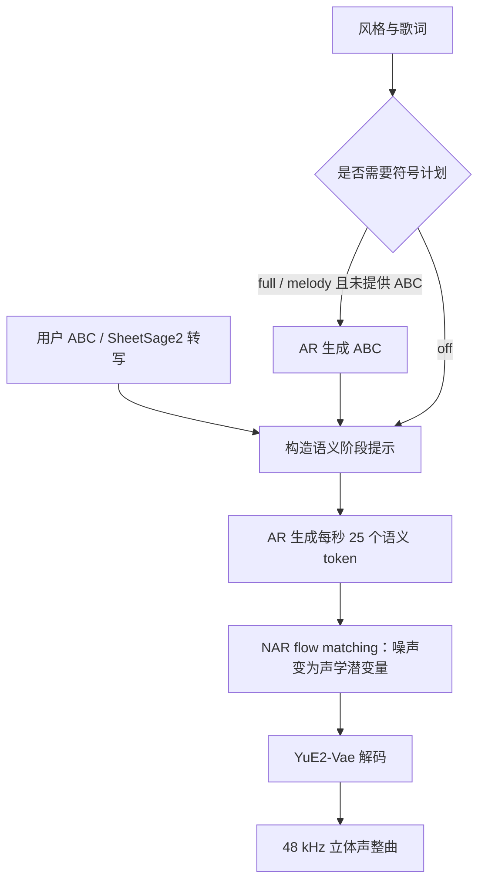

# YuE2：先写可编辑的音乐计划，再让它发声

> 面向 Omni 与 AI 初学者。核对日期：2026-10-15；实现快照：vLLM-Omni `910b8f07d23c7f387729173333c9d5f927dc6c4f`。本文讲 YuE2-3B，不沿用 YuE 第一代的双阶段离散 codec 架构描述；本文没有重新运行 GPU 性能测试。

## 从 checkpoint 到模型结构：先认识层数和矩阵

### A. 固定两份模型，不只记住“3B”

本次实际读取的 Hugging Face revision 是：

- `m-a-p/YuE2-3B`：`8f24312f187763b9854adeec87e437e2b03bbff1`。
- `m-a-p/YuE2-Vae`：`152733a19ad43aa67e367f9b5503ef8075bb5126`。

[主模型文件树](https://huggingface.co/m-a-p/YuE2-3B/tree/8f24312f187763b9854adeec87e437e2b03bbff1) 和 [VAE 文件树](https://huggingface.co/m-a-p/YuE2-Vae/tree/152733a19ad43aa67e367f9b5503ef8075bb5126) 的加载核心文件如下：

```text
YuE2-3B/                       YuE2-Vae/
├── config.json                ├── config.json
├── model.safetensors          ├── model.safetensors
├── modeling_yue2.py            ├── modeling_vae.py
├── qwen.tiktoken               └── weights_manifest.json
├── generation_config.json
├── yue2_generation_config.json
└── weights_manifest.json
```

`config` 像装配说明，safetensors 像装好每一块积木所需的真实矩阵；`modeling_*.py` 是官方 Transformers 实现，Omni 则通过自己的已注册模型执行。

本节仅用 HTTP Range 读取 safetensors 的长度字段与 JSON header，没有下载整个权重。主模型 header 为 73184 字节，VAE 为 48192 字节；里面能直接读取名称、shape 与 dtype。

[精简 checkpoint 清单](checkpoints/yue2.json) 保留选中的真实 tensor、实际配置与来源。下面明确区分“配置值”“实读 shape”与“根据维度做的推导”。

### B. 主模型 config：28 层不是全部故事

主 checkpoint 实际 config 给出：

```text
hidden_size               2048
num_hidden_layers         28
num_attention_heads       16
num_key_value_heads       8
head_dim                  128
intermediate_size         6144
vocab_size                184704
max_position_embeddings   24576
latent_dim                64
max_latent_frames         24576
```

header 中同时出现 `model.layers.0` 到 `model.layers.27` 的普通 attention/MLP 和 `nar_*` 权重。这说明 28 个层编号各包含 AR 与 NAR 路径，不能理解成“总共 28 个小操作”。

$16\times128=2048$ 是 query 的注意力总宽度，$8\times128=1024$ 是 K/V 总宽度。因此一组 K/V 可以服务多组 query，这叫 GQA（Grouped Query Attention，分组查询注意力）。

`vocab_size` 是完整词表，含普通文字、特殊协议标记与音频 token 区间；不是 184704 个汉字，也不是音频码本只有这么多帧。

### C. 用实读矩阵理解一次 Transformer 层

下面是主模型 header 中的真实名称、shape；这些选中矩阵均为 BF16：

```text
model.embed_tokens.weight                         [184704,2048]
lm_head.weight                                    [184704,2048]
model.layers.0.self_attn.q_proj.weight             [2048,2048]
model.layers.0.self_attn.k_proj.weight             [1024,2048]
model.layers.0.self_attn.v_proj.weight             [1024,2048]
model.layers.0.self_attn.o_proj.weight             [2048,2048]
model.layers.0.mlp.gate_proj.weight                [6144,2048]
model.layers.0.mlp.up_proj.weight                  [6144,2048]
model.layers.0.mlp.down_proj.weight                [2048,6144]
model.layers.0.nar_self_attn.q_proj.weight         [2048,2048]
model.layers.0.nar_self_attn.k_proj.weight         [1024,2048]
model.layers.0.nar_mlp.gate_proj.weight            [6144,2048]
```

PyTorch Linear 的矩阵按 `[out_features,in_features]` 存储：输入最后一维是 `in`，输出最后一维是 `out`，实际运算为 $Y=XW^\top$（若有 bias 再加 bias）。

设一批输入为 `[B,S,2048]`，其中 B 是请求数、S 是序列位置数：

```text
q_proj: [B,S,2048] → [B,S,2048] → [B,S,16,128]
k_proj: [B,S,2048] → [B,S,1024] → [B,S,8,128]
v_proj: [B,S,2048] → [B,S,1024] → [B,S,8,128]
attention + o_proj:                     → [B,S,2048]
```

vLLM 通常进一步把不同请求的 token 打包成 `[rows,2048]`；这是批处理布局变化，不改变最后一维的投影逻辑。

FFN 是前馈网络：gate/up 都把 2048 维变成 6144 维，做门控非线性后，down 再压回 2048 维。不是一条宽度永远不变的直线。

Embedding 则不是 Linear：输入 token 编号 `[B,S]`，按行查询 `[184704,2048]`，得到隐藏向量 `[B,S,2048]`。最后 lm_head 把隐藏向量投到词表分数空间 `[B,S,184704]`。

两份 embedding/head 的 shape 相同不代表共用同一块权重；该 checkpoint 的 `tie_word_embeddings=false`，header 也有分别命名的 tensor。

### D. 连续声音与 Transformer 之间的桥

```text
vae2llm.weight                 [2048,64]    BF16
llm2vae.weight                 [64,2048]    BF16
time_embedder.mlp.0.weight     [2048,256]   BF16
time_embedder.mlp.2.weight     [2048,2048]  BF16
```

输入声学状态为 `[B,T,64]`，`vae2llm` 把它映射为 `[B,T,2048]`；加入时间与位置条件后进入 NAR Transformer。输出经 `llm2vae` 回到 `[B,T,64]`，表示本次求值预测的速度场。

时间输入不是直接拿单个数字复制 2048 次：先由时间特征构造 256 维表示，再由上述两层 MLP 映射到隐藏空间。时间进度与歌曲播放位置是两种不同的条件。

### E. VAE 是卷积解码器，不能照搬 attention 的层数解释

实际 `YuE2-Vae` config 给出：

```text
sample_rate 48000；audio_channels 2；latent_dim 64
channels 64；c_mults [1,2,4,8,16,32]
strides [2,2,4,4,5,6]；downsampling_ratio 1920
decoder_config.final_tanh false；dtype float32
```

这里有六个 decoder 上采样块，按反向 stride 次序 `6,5,4,4,2,2` 展开时间轴。倍率相乘为 $6\times5\times4\times4\times2\times2=1920$，这解释一帧潜变量怎样对应 1920 个波形采样点。

实读代表权重如下，dtype 都是 F32：

```text
decoder.layers.0.weight_v             [2048,64,7]
decoder.layers.0.weight_g             [2048,1,1]
decoder.layers.1.layers.1.weight_v    [2048,1024,12]
decoder.layers.2.layers.1.weight_v    [1024,512,10]
decoder.layers.6.layers.1.weight_v    [64,64,4]
decoder.layers.8.weight_v             [2,64,7]
```

普通 `Conv1d` 的权重布局为 `[out_channels,in_channels,kernel_size]`；所以首层把 `[B,64,T]` 的通道维映射到 2048，最后一层把 64 个特征通道变成左右两声道。

中间使用 `ConvTranspose1d` 上采样，其权重布局为 `[in_channels,out_channels,kernel_size]`，与普通卷积前两维相反。不能把 `[2048,1024,12]` 当作一个 Linear 的 `[out,in]`。

`weight_g`、`weight_v` 来自 weight normalization（权重归一化）：实际卷积权重由方向与尺度重建。header 里没有直接叫 `weight`，不表示卷积缺少权重。

上采样块内部还有 Snake 激活和残差单元，因此“六个上采样块”不等于“整个 VAE 只有六层”。本节报块数，避免把 Transformer 层与卷积子层混着相加。

### F. 磁盘名字怎样映射到实际模块

[`partition_checkpoint_weights`](https://github.com/vllm-project/vllm-omni/blob/910b8f07d23c7f387729173333c9d5f927dc6c4f/vllm_omni/model_executor/models/yue2/yue2.py#L140) 把普通 AR 权重交给 vLLM loader，把 `nar_*` 和声学投影分到另一组。

例如：

```text
checkpoint: model.layers.0.nar_self_attn.q_proj.weight
runtime:    nar_layers.0.self_attn.q_proj.weight
```

规则是移除层内 `nar_` 前缀，并把顶层 `model.layers` 改为 `nar_layers`。不是重新训练了一个形状相似的网络。

[`load_weights`](https://github.com/vllm-project/vllm-omni/blob/910b8f07d23c7f387729173333c9d5f927dc6c4f/vllm_omni/model_executor/models/yue2/yue2.py#L2136) 加载后检查缺失/意外参数，再调用 `fuse_nar_projections`。因此磁盘中的 q/k/v 三个矩阵在运行时可能合并；合并改变执行组织，不改变它们分别投影的含义。

VAE 的 `from_pretrained` 以 `decoder_only=True` 只取 `decoder.*`，并要求导出 tensor 为 FP32、名称完整匹配，再拷入模型。checkpoint 还带 encoder，不代表每次生成都要先运行 encoder。

现在再看下面的 pipeline，就能把每个箭头对应到具体矩阵与数据形状。


## 1. 从一首歌的三种描述开始

假设你想生成一首轻快的中文流行歌，有歌词“风吹过站台，我还在等待”。可以描述它的方式有三种：

- **语言**：轻快、原声吉他、温暖男声、约 100 BPM。
- **乐谱**：哪些音在什么时候响、持续多长、配什么和弦。
- **声音**：最终人声、吉他、混响共同组成的波形。

YuE2 的特点是把语言、可编辑的符号计划和声音生成接起来。它可以先规划旋律与和弦，再生成完整音乐；也可以关闭这一步，直接在文字条件下生成声音表示。

先把它想成“作曲草稿 → 演奏安排 → 录音”，但不要把类比当成三个完全独立的模型。实际实现把 AR 与 NAR 路径放在同一个检查点、同一个 Omni stage 内，VAE 解码器另行加载。

学习本章时，优先回答三个问题：**模型预测什么、哪些步骤必须串行、哪些计算可以复用**。

## 2. 模型家族与外部工具的分工

本章的主模型是 `m-a-p/YuE2-3B`。官方项目仍位于名为 `YuE` 的 GitHub 仓库，不能因为仓库名相同就把第一代代码说明直接套用过来。

与之经常一起出现的模型分别是：

- `YuE2-3B`：文字/符号计划 → 语义音频 token → 声学潜变量。
- `YuE2-Vae`：默认听感解码器，把潜变量变成 48 kHz 立体声。
- `YuE2-Vae-legacy`：复现特定官方 benchmark 协议时使用的另一解码器。
- `SheetSage2`：把参考录音转成可读的乐谱信息，帮助构造 Cover 的计划。
- `MERT-v2`：在相关分析工具中承担音乐表征角色，不是每次 YuE2 生成都要额外下载的独立前置模块。

这里的 Cover 指“利用转写出的旋律计划重新演绎”，不能直接等同于声音克隆或 SVC（Singing Voice Conversion，歌声音色转换）。后者通常更直接地以源音频为条件改变声音。

[官方项目](https://github.com/multimodal-art-projection/YuE)、[官方生成说明](https://github.com/multimodal-art-projection/YuE/blob/main/docs/generation.md)、[官方模型与工具分工](https://github.com/multimodal-art-projection/YuE/blob/main/skills/yue2-music/references/models-and-setup.md)。

## 3. 四种表示，分别承担什么工作

### 3.1 文字 token：描述要求

Tokenizer 把风格和歌词变成整数序列。YuE2 本地适配使用冻结的 `qwen.tiktoken` BPE tokenizer，并不是让 GPT-2 tokenizer 真正编码歌词。

部署文件中 `tokenizer: gpt2` 配合 `skip_tokenizer_init: true` 是引擎配置占位。实际提示以 `prompt_token_ids` 进入，这个细节对第一次读代码的人很容易造成误会。

### 3.2 ABC：可以读写的符号计划

ABC 是一种用文字表达音乐的记谱方式。把它理解为“文本版乐谱”，不是原始音频，也不是模型隐藏状态。

下面只用于理解基本记法，**不是可以直接提交的完整 YuE2 原生双声部计划**：

```text
X:1
M:4/4
L:1/4
K:C
C D E G | G E D C |
```

它展示调号、拍号、音符及小节。YuE2 原生计划还有自己的声部与结构约定；实际输入应以官方导出、模型生成或 SheetSage2 的兼容输出为起点。

修改 ABC 可以明确改变旋律计划，但模型是条件生成器，并非传统确定性合成器，因此音频不保证每个细节严格遵守记谱。

### 3.3 语义音频 token：低频率的音乐骨架

本地 YuE2 使用单码本语义序列，每帧一个离散 token，码本大小为 32768，频率为每秒 25 帧。

设音乐时长为 $D$ 秒，语义帧数大约为：

$$
T=25D.
$$

例如 20 秒约 500 帧，而 48 kHz 的单声道波形在 20 秒内有 960000 个采样点。低频率 token 让 AR 模型不用逐个预测波形采样。

“语义”不代表这里只存歌词含义。它是训练所得的音频压缩表示，包含对生成音乐有用的内容。

### 3.4 连续声学潜变量：让骨架长出质感

声学潜变量（latent）是实数向量。本地 NAR 路径得到：

$$
Z\in\mathbb{R}^{T\times64}.
$$

它与语义 token 按时间对应，但不是把整数编号直接转成 64 个 PCM 采样值。

VAE 是 Variational Autoencoder，变分自编码器；推理主要使用其解码端，把压缩连续表示展开为声音。代码将 $[T,64]$ 转为 $[1,64,T]$ 后解码，最终得到声道在前的 $[2,S]$ 波形。

本地每帧对应 1920 个波形采样点，所以 $25\times1920=48000$。两个声道表示立体声，不是两位歌手。

## 4. Pipeline：算法多阶段，Omni 单阶段



这里 AR 是自回归，按顺序预测下一个 token；NAR 是 non-autoregressive，非自回归，在一次网络求值中一起更新许多声学帧。

`model_executor/models/yue2/pipeline.py` 只注册一个 `LLM_AR` stage。ABC 请求和语义请求可先后使用同一模型；终端声学合成也在该 stage 内触发。

为什么不拆成独立的 AR、NAR 引擎？当前适配的 AR 路径、NAR 路径、投影头来自同一个 MoT 检查点；单阶段避免跨 stage 重复持有这些权重。这是实现组织选择，不能推导成“生成只执行一次 forward”。

### 4.1 三种 cot 模式

这里的 `cot` 是公开接口中的控制名称：

- `full`：计划旋律与和弦。
- `melody`：仅计划旋律，不要求和弦标记。
- `off`：跳过符号计划。

它指的是可见的音乐计划，不是一个额外隐藏的通用聊天推理模型。

本地 `abc_prefix_ids` 生成到 `ABC_START` 为止的提示；ABC 阶段遇 `ABC_END` 停止。`semantic_prefix_ids` 再把计划放到提示中，追加 `MUSIC_START`，启动语义音频生成。

### 4.2 在线接口与离线能力不完全相同

当前 `tts_adapters/yue2.py` 的 speech API 默认 `cot=off`；若选择 `full` 或 `melody`，必须同时提供 `abc`。自动生成 ABC 需要两次顺序引擎请求，当前在线适配没有编排这一步，应走离线示例。

在线接口复用了 `/v1/audio/speech`，但任务仍是音乐生成：`input` 是歌词，`instructions` 是音乐描述。URL 名叫 speech 并不意味着模型变成了 TTS。

该接口明确拒绝参考音频、流式返回和不适用的说话人选择。Cover 的录音转谱流程不能直接塞进 `ref_audio` 假装等价。

## 5. 主模型结构：Mixture-of-Transformers

MoT 是 Mixture of Transformers。在这个实现里，可以从两条路径理解它：

- AR 路径以 vLLM 原生 `Qwen3Model` 执行因果序列建模。
- NAR 路径拥有相应声学层，负责连续潜变量的流匹配计算。
- `vae2llm`、`llm2vae` 在线性空间之间投影，连接 64 维声学表示和 Transformer 隐藏表示。
- 时间嵌入告诉网络当前去噪/流匹配的进度；位置嵌入告诉它处理的是哪一帧。

不能把 MoT 和 MoE 混为一谈。这里的名字不意味着 Drama 3 那样为每个 token 在许多稀疏专家间路由。

本次固定 checkpoint 的实际配置为隐藏维度 2048、28 层、16 个 query heads、8 个 KV heads、head dimension 128（见前置权重核对）。AR 是 Qwen3-1.7B 形态，不代表整个 YuE2 只有一个 Qwen3-1.7B：另有 NAR 权重与相关头，模型名的 3B 也不应拿来当精确的推理显存估计。

## 6. AR 为什么仍然需要一个一个生成

语义序列的概率可以分解为：

$$
p(s_1,\ldots,s_T\mid c)=\prod_{t=1}^{T}p(s_t\mid c,s_{<t}),
$$

$c$ 表示歌词、风格和可选计划。采样 $s_t$ 之前，不知道后续真实抽到的 $s_{t+1}$，所以普通 AR 推理有时间步依赖。

KV cache 可以避免把历史 token 的层计算重做一遍；它不能把这个概率依赖自动删除。歌曲越长，语义步数一般越多，因此要同时看 token/s 与目标时长。

例如每秒声音需要 25 个语义帧，但这还没有计算 NAR 和 VAE。只测到 AR 超过 25 token/s，不能立即宣称端到端实时。

## 7. NAR 为什么能同时处理多帧

NAR 不再采样下一个离散语义 token。它拿到整段语义条件，并把一组连续噪声逐步变为声学潜变量。

可以把网络预测记为速度场 $v_\theta(z_t,t,c)$：它告诉当前状态在流动过程中的变化方向。

其中 $z_t$ 是进度 $t$ 下整段声学潜变量的当前状态，$\theta$ 代表训练好的网络参数，$c$ 是保持固定的条件。$t$ 是生成过程的进度，不是歌曲播放到第几秒。

本地求解从 $t=1$ 向 $0$ 移动。约定步长大小 $\Delta t>0$，因此更新式使用减号；$z_{mid}$ 是试探半步后的状态。中点法做：

$$
z_{mid}=z_t-\frac{\Delta t}{2}v_\theta(z_t,t,c),
$$

$$
z_{t-\Delta t}=z_t-\Delta t\,v_\theta(z_{mid},t-\Delta t/2,c).
$$

先试探走半步，再根据半步位置决定完整一步，比始终只看起点多一次修正机会。

用一个标量教学例子：设 $z_t=2$、$\Delta t=0.1$，并假设速度场简单到 $v(z,t,c)=z$。第一次求值得到速度 2，所以 $z_{mid}=2-0.05\times2=1.9$；第二次速度为 1.9，于是 $z_{t-0.1}=2-0.1\times1.9=1.81$。这里的数字和速度函数只是演示中点更新，并非 YuE2 的模型运行值；真实网络同时处理许多帧的 64 维向量。

本地默认 32 步，每一步两次速度场计算，即每个 acoustic chunk 64 次网络求值。**32 步不是总共 32 个 kernel，也不是 32 个自回归音频 token。**

每次网络求值可一起更新多帧，但不同 ODE 步仍串行依赖。所谓 NAR 并不代表“一个算子就生成整首歌”。

## 8. 最关键的简化：固定条件不用每一步重算

NAR 每次迭代都需要读取歌词、ABC、语义 token 形成的条件前缀。这个前缀在整次声学求解中保持不变。

本地 `CachedNAR._prefill` 先计算条件前缀每一层的 K/V。之后 `_velocity` 保留这部分缓存，只覆写当前声学状态产生的 K/V。

为什么正确？条件前缀走因果 AR 路径，不依赖后面的声学潜变量；所以 $z_t$ 改变时，条件的投影不变。

设固定前缀长 $P$、声学块长 $A$，网络求值次数为 $N$：

- 直接重做会重复进行约 $N$ 次前缀网络计算。
- 缓存后前缀只预填充一次，随后重复的是声学部分以及它对条件的注意力读取。

因此不能把整段注意力复杂度写成“全部除以 64”。读取固定条件仍有成本；变化的是重复前缀计算被消掉。

形象地说：乐队排练时乐谱没改，就不必每次重新誊写乐谱；当前演奏状态仍要重新调整。

## 9. 本地已经实现的工程优化

以下均指核对 SHA 中的实现，收益需要在目标机器重新测量。

**NAR 投影融合。** `fuse_nar_projections` 合并 Q/K/V 及 gate/up 等线性投影，减少小矩阵调用和 kernel 发起次数。

**编译局部算子。** `_nar_kernels` 对 attention 前后计算使用 `torch.compile`；不是声称整个 Python 生命周期都进入一个无分支大图。

**CUDA Graph 回放。** 同一个 acoustic chunk 的形状在 64 次速度场求值间保持不变；`CachedNAR.velocity` 为静态输入地址捕图，然后更新输入并回放。省的是重复调度成本，网络求值次数没有被抹掉。

**可选快速 attention。** 代码选择可用的快速 attention 路径并保留回退。需要区分“环境能 import”与“本次实际选中了哪个 kernel”。

**采样器图。** `SamplerGraph` 为重复的采样计算提供图执行，避免把优化只盯在 Transformer 上。

**声学合成与其他请求重叠。** `_SynthesisQueue` 用 side stream 分单位推进；一首歌进入终端合成时仍占 slot，并通过 HOLD token 保持请求存活。其他请求可以继续推进，不代表这首歌已经流式出声。

**VAE 分块解码。** 以核心块加两侧 halo 的方式解码，降低长曲激活峰值并处理边界。halo 是上下文，不应该被重复拼到最终波形。

## 10. 哪些开关不能直接照抄

当前 `deploy/yue2.yaml` 默认：`max_num_seqs=4`、AR `enforce_eager=true`、prefix caching 关闭、`async_chunk=false`。

注意三个容易误判的地方：

1. AR eager 不意味着 NAR 与采样器没有自己的图执行；它们是独立路径。
2. Prefix caching 关闭不意味着上面讲的 NAR 固定条件缓存没有启用；二者层级不同。
3. Side stream 异步合成不意味着接口支持边生成边播放；当前返回的是终端整曲音频。

本地注释说明 prefix cache 命中时尾部预填充与完整预填充存在浮点差异，同种子也可能产生不同歌曲。随机种子不是跨配置音频逐样本一致的保证。

当前模型构造显式拒绝 TP>1 或 PP>1，因为 NAR 路径尚不能与这些切分保持一致。不能把增加并行参数当作现成的多 GPU 提速方案。

生成帧预算、HOLD 预算、终止 token 都占引擎 token 预算。只把 `max_tokens` 等于音频帧数，可能在音频合成结束之前就把请求截断。

## 11. 怎样做有解释力的优化实验

先分别记录 ABC、语义 AR、NAR、VAE、总耗时及峰值显存；再报告声音时长与 RTF。固定提示、ABC、种子、并发、解码器版本和硬件，只改一个因素。

- 缩短帧预算：直接减少工作量，但也缩短作品，不能冒充同一任务提速。
- 减少 ODE 步数：是质量与计算的交换，需要听感和数值稳定性检查；当前默认常量不是现成的在线请求参数。
- 增大并发：可能提高吞吐，也可能拉高单曲延迟和合成显存峰值。
- 更换 VAE：可能影响速度与听感，比较 benchmark 时必须记录具体版本。

验证不能停在 HTTP 200。至少检查波形非空、有限值、真实时长、是否截断，并听旋律、歌词、段落边界和人声是否变成念白。

## 12. 从源码读到可贡献的问题

以下路径均相对 vLLM-Omni：

1. `vllm_omni/model_executor/models/yue2/pipeline.py`：解释为何单 stage。
2. `vllm_omni/tokenizers/yue2_prompt.py`：比较 `abc_prefix_ids` 与 `semantic_prefix_ids`。
3. `vllm_omni/transformers_utils/configs/yue2.py`：把层数、head、latent dimension 对上数据流。
4. `vllm_omni/model_executor/models/yue2/yue2.py::Yue2ForCausalLM`：从初始化找 AR、NAR、投影层与 VAE。
5. 同文件 [`CachedNAR`](https://github.com/vllm-project/vllm-omni/blob/910b8f07d23c7f387729173333c9d5f927dc6c4f/vllm_omni/model_executor/models/yue2/yue2.py#L553) 的 `_prefill`、`_velocity`、`solve_iter`：理解一次缓存、多次迭代。
6. 同文件 [`_SynthesisQueue`](https://github.com/vllm-project/vllm-omni/blob/910b8f07d23c7f387729173333c9d5f927dc6c4f/vllm_omni/model_executor/models/yue2/yue2.py#L1839)、`_queue_synthesis`、`_ship_audio`：理解请求结束与音频交付并非同一个时刻。
7. [`vllm_omni/entrypoints/openai/tts_adapters/yue2.py::Yue2Adapter.validate`](https://github.com/vllm-project/vllm-omni/blob/910b8f07d23c7f387729173333c9d5f927dc6c4f/vllm_omni/entrypoints/openai/tts_adapters/yue2.py#L84)：看接口真实支持范围。
8. `vllm_omni/deploy/yue2.yaml`：把并发、显存与 token 预算连起来。

[固定版本源码](https://github.com/vllm-project/vllm-omni/tree/910b8f07d23c7f387729173333c9d5f927dc6c4f/vllm_omni/model_executor/models/yue2)。初学者可以先贡献阶段计时、错误信息、预算说明或可复现的音频验证，再进入注意力 kernel 和图捕获。

## 13. 理解检查

1. 为什么 10 秒音乐约有 250 个语义 token，却还有后续大量计算？
2. 为什么能缓存 NAR 条件前缀，不能缓存全部变化中的声学 K/V？
3. `cot=full` 的在线请求为什么仍需要用户提供 ABC？
4. 两声道是否等于两名歌手？

参考答案：token 是压缩骨架，后面还有多次流匹配与 VAE；条件固定而声学状态每步变化；当前在线适配尚未编排自动 ABC 的两次请求；声道是空间输出格式，声部与歌手是音乐内容。

## 延伸阅读

- [YuE2 论文](https://arxiv.org/abs/2609.33757)：符号与音频联合生成的原始研究材料。
- [模型权重与模型卡](https://huggingface.co/m-a-p/YuE2-3B)：核对实际模型版本与使用条件。
- [官方生成指南](https://github.com/multimodal-art-projection/YuE/blob/main/docs/generation.md)：实际输入、计划模式与输出。
- [官方评测范围](https://github.com/multimodal-art-projection/YuE/blob/main/docs/benchmarks.md)：不要把特定自动指标排名理解成所有人的听感结论。
